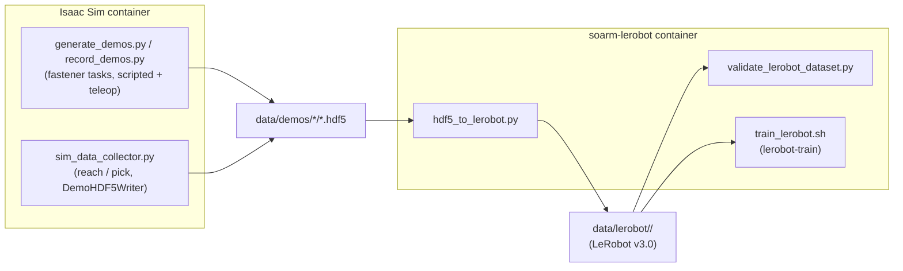

# Data Pipeline

How episodes are recorded, converted to LeRobot datasets, and consumed for training.

All recording paths write a **demo HDF5 file** first (Isaac Lab's `record_demos` format,
described in `isaac_envs/soarm_tasks/demo_schema.py`). One converter,
`training/scripts/hdf5_to_lerobot.py`, turns those files into a **LeRobot v3.0** dataset with
the LeRobot API itself (`LeRobotDataset.create` / `add_frame` / `save_episode`), using the
pinned lerobot 0.6.1 in the `soarm-lerobot` image. Nothing in the repo writes LeRobot files by
hand any more (the old `LeRobotWriter` did, and LeRobot could not load its output, #34).



---

## Step 1: record demos (HDF5)

- Fastener tasks (`Soarm-PickPlace-Fastener-*`): scripted and teleop demos, see the fastener
  [Demonstrations](ISAAC_SIM_ENVIRONMENTS.md#demonstrations-issue-33) (`soarm_tasks/scripts/generate_demos.py`,
  teleop via `record_demos.py`). Output e.g. `data/demos/fastener_m6/scripted.hdf5`.
- Reach / cube pick (`SoarmReachEnv`, `SoarmPickEnv`): `./scripts/collect_sim_data.sh` runs
  `isaac_envs/sim_data_collector.py`, which writes `data/episodes/<env>.hdf5`:

```bash
./scripts/collect_sim_data.sh --env reach --episodes 50     # -> data/episodes/reach.hdf5
./scripts/collect_sim_data.sh --env pick --episodes 100     # -> data/episodes/pick.hdf5
```

What the converter reads from each `demo_<k>` group (all angles in radians, contract joint
order, `isaac_envs/soarm_common/contract.py`):

| HDF5 | Shape | LeRobot feature |
|---|---|---|
| `joint_pos_targets` | (T, 6) float32 | `action`: absolute joint-position targets |
| `obs/joint_pos` | (T, 6) float32 | `observation.state`: joint positions before the action |
| `obs/wrist_rgb` | (T, 224, 224, 3) uint8 | `observation.images.wrist` (video) |
| `obs/overhead_rgb` | (T, 224, 224, 3) uint8 | `observation.images.overhead` (video) |
| attr `prompt` | str | the episode's `task` |

`sim_data_collector.py` files hold only these datasets (plus `actions`), not the scene states
that `replay_demos.py` needs. Run it with cameras (the default): `--no-camera` files have no
images and the converter rejects them.

## Step 2: convert to LeRobot v3.0

Run in the LeRobot image. The `lerobot` compose service mounts `data/` at `/workspace/data` and
`isaac_envs/` and `training/` read-only at `/isaac_envs` and `/training`:

```bash
cd docker
docker compose --profile train-lerobot run --rm -e NVIDIA_VISIBLE_DEVICES=void lerobot \
    python /training/scripts/hdf5_to_lerobot.py \
        /workspace/data/demos/fastener_m6/scripted.hdf5 \
        /workspace/data/demos/fastener_m6/teleop_selftest2.hdf5 \
        --output-root /workspace/data/lerobot/fastener_m6 --repo-id local/fastener_m6
```

Options: `--source scripted` (repeatable) keeps only demos with that `source` attribute,
`--include-failed` also converts demos with `success=False` (skipped by default), `--vcodec h264`
picks another codec (default: LeRobot's AV1), `--overwrite` replaces an existing dataset.
Each demo becomes one episode with one task string, at `fps` = the contract's 30 Hz control rate.
The 50 scripted + 1 teleop M6 demos (11,801 frames, 817 MB of HDF5) convert in about 4 minutes
to a 30 MB dataset.

## Step 3: validate

```bash
docker compose --profile train-lerobot run --rm -e NVIDIA_VISIBLE_DEVICES=void lerobot \
    python /training/scripts/validate_lerobot_dataset.py /workspace/data/lerobot/fastener_m6 \
        --hdf5-dir /workspace/data/demos/fastener_m6 --expect-episodes 51
```

It loads the dataset with `LeRobotDataset(repo_id, root=...)` and checks fps, robot type, the
camera keys, state/action dtype, shape and joint names, that stats exist for every feature, the
episode count, per-episode length and task, that state/action equal the HDF5 exactly, and that
sampled video frames decode to the HDF5 images within a mean absolute error of 4 (0-255 scale).
Video is lossy: on the M6 set the error per frame is 1.1-2.5. A swapped camera gives 30 or more,
swapped colour channels 11 or more.

## Step 4: train

```bash
./scripts/train_lerobot.sh --policy act --dataset data/lerobot/fastener_m6 --steps 20000
```

See [LEROBOT_TRAINING.md](LEROBOT_TRAINING.md).

---

## LeRobot v3.0 layout

What lerobot 0.6.1 writes (`data/lerobot/fastener_m6`):

```
data/lerobot/fastener_m6/
├── meta/
│   ├── info.json                  fps, robot_type, features, file path templates
│   ├── stats.json                 per-feature min/max/mean/std/count + q01..q99 (images too)
│   ├── tasks.parquet              task strings -> task_index
│   ├── episodes/chunk-000/file-000.parquet   per-episode length, tasks, row and video ranges
│   └── soarm_sources.json         ours: episode -> HDF5 file, demo, source, seed (LeRobot ignores it)
├── data/chunk-000/file-000.parquet           one row per frame, all episodes
└── videos/
    ├── observation.images.wrist/chunk-000/file-000.mp4      all episodes concatenated
    └── observation.images.overhead/chunk-000/file-000.mp4
```

Data rows have `observation.state` and `action` (float32[6]) plus LeRobot's `timestamp`,
`frame_index`, `episode_index`, `index` and `task_index`. Episodes share files; LeRobot starts
a new file when one passes 100 MB (data) or 200 MB (video). Video features in `info.json`
record the codec: AV1 (`libsvtav1`), CRF 30, GOP 2, yuv420p. torchcodec decodes it on the CPU.

LeRobot computes `meta/stats.json` itself while saving episodes, so there is no separate
normalization step for LeRobot training. (`training/scripts/compute_norm_stats.py` belongs to
the OpenPi path below and reads the old flat layout.)

The contract names the task key `language_instruction` (`DATASET_TASK_KEY`, used by the OpenPi
config); in a LeRobot v3.0 dataset the task is the per-frame `task` string that becomes
`task_index` and `meta/tasks.parquet`.

---

### Domain Randomization

The Isaac Lab environments apply the following randomization at each
episode reset:

| Parameter | Range | Purpose |
|---|---|---|
| Target position | X: 5-25 cm, Y: -15-15 cm, Z: 2-20 cm | Task diversity |
| Initial joints | Gaussian noise, sigma=0.1 rad | Starting pose variety |
| Cube position (pick) | X: 8-22 cm, Y: -10-10 cm | Object placement variety |
| Lighting | Dome light, 2000 lux | (constant, extend for randomization) |

To improve sim-to-real transfer, you can extend the environments with
texture randomization, camera noise, and dynamics randomization.

---

## SO-ARM101 State and Action Spaces

Both vectors use the contract joint order and radians (`soarm_common/contract.py`, limits from
the URDF). LeRobot's own SO-101 robot driver records degrees / normalized ranges instead; this
project's datasets stay in radians end to end (sim, dataset, ROS 2, policy server).

### State Vector (observation.state)

| Index | Joint | Limits (rad) | Description |
|---|---|---|---|
| 0 | `shoulder_pan` | -1.920 to 1.920 | Base rotation |
| 1 | `shoulder_lift` | -1.745 to 1.745 | Shoulder up/down |
| 2 | `elbow_flex` | -1.690 to 1.690 | Elbow bend |
| 3 | `wrist_flex` | -1.658 to 1.658 | Wrist pitch |
| 4 | `wrist_roll` | -2.744 to 2.841 | Wrist roll |
| 5 | `gripper` | -0.175 to 1.745 | ~0 closed, 1.745 fully open |

### Action Vector

Same 6-element layout: the absolute joint-position target sent to the joint drives for the next
control step (1/30 s), gripper included (`contract.ACTION_TYPE = "absolute_joint_position"`).
The OpenPi config can turn the arm joints into deltas at training time
(`use_delta_joint_actions=True`, gripper stays absolute); the dataset always stores absolute
targets.

---

---

## OpenPi normalization statistics (legacy path)

The OpenPi LoRA path (`training/configs/soarm_config.py`, [OPENPI_TRAINING.md](OPENPI_TRAINING.md))
predates the LeRobot v3.0 conversion. `training/scripts/compute_norm_stats.py` reads
`<dir>/data/*.parquet` of the old flat layout and writes `meta/stats.json` with
mean/std/min/max of `observation.state` and `action`. Do not run it on a dataset made by
`hdf5_to_lerobot.py`: LeRobot already wrote a fuller `meta/stats.json` there (and the script
finds no parquet files at the top of `data/`, so it does nothing). Pointing OpenPi at
v3.0 datasets is not done yet.

---

## Converting other data

Write it as a demo HDF5 file with at least the datasets in the table under Step 1, a `prompt`
attribute per `demo_<k>` group and the `soarm_joint_names` file attribute
(`demo_schema.file_attrs()`), then run `hdf5_to_lerobot.py`. `DemoHDF5Writer` in
`isaac_envs/sim_data_collector.py` is a small example. (`training/scripts/convert_sim_episodes.py`,
which wrote the old flat layout from `.npy` files, was removed with `LeRobotWriter`.)
