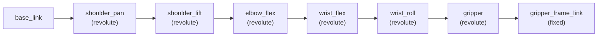

# Isaac Sim Environments

Details on the custom Isaac Lab environments for the SO-ARM101.

---

## Overview

Two Gymnasium-compatible environments are provided, built on NVIDIA's
Isaac Lab framework.  Both load the SO-ARM101 from its USD asset and run
inside the Isaac Sim physics engine.

| Environment | File | Task | Episode Length |
|---|---|---|---|
| **SoarmReachEnv** | `isaac_envs/soarm_reach_env.py` | Move EE to target | 5 s |
| **SoarmPickEnv** | `isaac_envs/soarm_pick_env.py` | Pick cube, place at target | 10 s |
| **Soarm-PickPlace-Fastener-\*-v0** (manager-based) | `isaac_envs/soarm_tasks/` | Pick a fastener, place it in a bin | 20 s |

---

## SO-ARM101 Robot Model

### Joint Configuration



### Actuator Properties

| Group | Joints | Stiffness | Damping | Effort Limit | Velocity Limit |
|---|---|---|---|---|---|
| Arm | shoulder_pan, shoulder_lift, elbow_flex, wrist_flex, wrist_roll | 80 | 4 | 30 Nm | 2 rad/s |
| Gripper | gripper | 80 | 4 | 10 Nm | 2 rad/s |

These approximate the STS3215 servos used in the real SO-ARM101.

---

## SoarmReachEnv

### Task

Move the end-effector (gripper_frame_link) to a randomly sampled 3D target
position within the robot's workspace.

### Observation Space

| Component | Dimension | Description |
|---|---|---|
| Joint positions | 6 | Current position of all 6 joints |
| Joint velocities | 6 | Current velocity of all 6 joints |
| Target position | 3 | XYZ target in world frame |
| **Total** | **15** | |
| Wrist camera (optional) | 224 x 224 x 3 | RGB image |

### Action Space

| Dimension | Range | Description |
|---|---|---|
| 6 | [-1, 1] | Scaled by `action_scale` (0.05 rad) and added to current joint positions |

### Reward

```
reward = -10 * distance_to_target + 5 * (distance < 2cm)
```

- Dense component proportional to end-effector distance from target
- Sparse bonus when within 2 cm (success threshold)

### Episode Termination

- **Success**: End-effector within 2 cm of target
- **Timeout**: 5 seconds (150 steps at 30 Hz policy rate)

### Domain Randomization

| Parameter | Range |
|---|---|
| Target X | 5 - 25 cm |
| Target Y | -15 - 15 cm |
| Target Z | 2 - 20 cm |
| Initial joint noise | Gaussian, sigma = 0.1 rad |

---

## SoarmPickEnv

Extends SoarmReachEnv with a manipulable cube.

### Task

Pick up a 3 cm cube from a random position and place it at a random target.

### Additional Observation

| Component | Dimension | Description |
|---|---|---|
| Cube position | 3 | XYZ in world frame |

Total observation: 15 (base) + 3 (cube) = **18**.

### Reward

Multi-phase reward:

```
reward = -5 * dist_ee_to_cube                              # reach
       + 2 * (grasped)                                     # grasp
       + 10 * (grasped AND cube_z > 5cm)                   # lift
       + 10 * (cube within 3cm of target)                  # place
```

### Additional Randomization

| Parameter | Range |
|---|---|
| Cube X | 13 - 25 cm |
| Cube Y | -10 - 10 cm |
| Cube Z | 1.5 cm (resting on table) |

### Scripted pick policy

`sim_data_collector.py --env pick` drives the arm with `ScriptedPick`: hover above the cube,
descend, close, lift, carry over the target, lower, release. It uses differential IK in pose
mode with the gripper pointing straight down.

How the grasp works:

| Setting | Value | Why |
|---|---|---|
| `solve_articulation_contact_last` | `True` (`SoarmReachEnvCfg.sim.physics`) | PhysX solves the jaw drive before the contacts by default, so the jaw pushes into the cube and squeezes it out. With the flag off, 1 of 10 episodes placed. |
| Wrist yaw | Lined up with the cube faces (nearest 90 deg) | If the jaws close on the cube at an angle, they catch its edges and the jaw stalls at 0.31-0.38 rad instead of 0.23-0.25. With the same physics, 11 of 20 placed without the alignment. |
| `GRASP_OFFSET` | 16 mm along -x of `gripper_frame_link` | From the jaw meshes, the fixed jaw's inner face is at x = +2..+4 mm, so a 3 cm cube touching it is centred at x = -13 mm. The extra 3 mm keeps the fixed jaw clear of the cube on the way down. |
| `GRASP_Z` | 10 mm | The jaw tips reach about 7 mm below `gripper_frame_link`. |
| Gripper goal | `GRIP_CONTACT - GRIP_SQUEEZE` = 0.24 - 0.14 = 0.10 rad | The jaw stalls on the 3 cm cube at 0.23-0.25 rad. The env's action clamp keeps the jaw target within 0.05 rad of its position, so the squeeze stays at about 4 N m or less. |
| Close phase | 45 steps | With 30 steps, the jaw was still closing when the lift began. |
| Joint-limit-aware IK | `respect_joint_limits` | Near the base (x < ~16 cm), top-down needs `wrist_flex` past its 95 deg limit. The pose IK kept asking for more, and the arm stalled 2-4 cm short, so the fixed jaw landed on the cube. Now joints at a limit are held there and the other joints fix the position. |
| `HOVER_TOL` | 4 mm | The fixed jaw clears the cube by ~3 mm, so a 1 cm hover tolerance could put it on top of the cube. |

You can override these settings with `--grip-contact`, `--grip-squeeze` and `--grasp-offset`.
Each episode line in the log shows the jaw angle at lift and the cube's peak height.

Measured success (issue #28): **20/20 placed** headless without cameras and 5/5 with cameras.
Before the joint-limit fix it was 15-18/20, with all misses on near-base cubes. With
`solve_articulation_contact_last=False` it was 1/10. The policy before #28 placed 0/5.

### Robot asset: importer-3.0 USD vs Isaac Lab `SO101_CFG` (issue #28)

We compared our USD with Isaac Lab's SO-101 SysID asset (`SO101_CFG` and `SO101_HIGH_PD_CFG`,
`Robots_Multiphysics/RobotStudio/so101_new_calib_SysID`, loaded from the NVIDIA asset server).
For the comparison we ran a scripted top-down grasp in `IsaacContrib-Stack-Cube-SO101-IK-Abs-v0`.

| | Our USD (`robot_description/usd/soarm101`) | Isaac Lab SysID USD / IK-Abs task |
|---|---|---|
| PhysX scene | `solve_articulation_contact_last=True`, bounce 0.01, friction corr. 6.25 mm (copied from the stack task) | same |
| Gripper drive | Implicit, k = 80, d = 4, effort 10 N m | USD: k = 1.19 N m/deg (68 per rad), d = 0.049 per deg, max force 3.35 N m. IK-Abs task: k = 17.8, d = 0.6, **effort 1 N m**, vel 2 rad/s |
| Arm solver iterations | 8 position / 0 velocity | 32 / 1 (USD physx variant); 8 / 0 in `SO101_CFG` |
| Jaw collision | Mesh convex decomposition (set at runtime in `SoarmPickEnv`) | Hand-made convex pieces per jaw |
| Materials | Cube friction 1.0 | Default |
| Prim layout | `Geometry/.../gripper_link/gripper_frame_link`, joints under `Physics/` | Flat links (`gripper`, `moving_jaw_so101_v1`) |

In our two A/B runs (3 and 5 episodes), every time the jaws landed on the 4 cm cube, the SysID
gripper held it through an 8 cm lift, stalled at 0.58 rad with only 1 N m. The other episodes
missed the cube: our open-loop script didn't calibrate where the cube sits in that asset's
gripper frame. We didn't debug this further.

**Decision: keep the importer-3.0 USD.** With the contact-last flag and the policy fixes, its
grasp holds (20/20 placed). It also needs no network asset server, and the rest of the stack (EE
link name, prim paths, cameras) is built on it. Two things are worth porting later if
sim-to-real fidelity matters:
- Real-servo gripper limits: about 3.35 N m. Our effort limit of 10 N m is higher than a real
  STS3215 servo can deliver.
- The SysID joint friction and armature.

---

## Fastener pick-and-place tasks (manager-based, `isaac_envs/soarm_tasks/`)

Gym-registered Isaac Lab tasks for the fastener tutorials (issue #32). Teleop/`record_demos.py`,
Mimic, multi-env data generation and evaluation build on them. They are modelled on Isaac Lab's
`contrib/stack/config/so101` cube-stack task. They use the same PhysX scene settings
(`soarm_common.robot.make_physx_cfg`, incl. `solve_articulation_contact_last`), its
`SO101PoseIKActionCfg` for the IK variant, and its observation groups (`policy`,
`subtask_terms`). The robot is our importer-3.0 USD (`soarm_common`), not the Isaac Lab SysID
asset, so no Newton/PhysX variant selection is involved.

| Task id | Action | Cameras |
|---|---|---|
| `Soarm-PickPlace-Fastener-JointAbs-v0` | 6: absolute joint targets in contract order (the contract action) | wrist + overhead |
| `Soarm-PickPlace-Fastener-IK-Abs-v0` | 8: `gripper_frame_link` pose in the base frame (pos, quat xyzw), then the gripper joint target (rad) | wrist + overhead |
| `Soarm-PickPlace-Fastener-State-v0` | 6: absolute joint targets | none; `policy` obs concatenated (RL) |
| `Soarm-PickPlace-Fastener-IK-Rel-v0` | 7: delta EE pose `[dx, dy, dz, rx, ry, rz]` + gripper ±1 (keyboard / SpaceMouse teleop, issue #33) | wrist + overhead |

**Importing.** `isaac_envs/` is mounted at `/isaac_envs` and isn't pip-installed. Put it on
`sys.path` and `import soarm_tasks` before `gym.make`. Isaac Lab's own scripts only import
`isaaclab_tasks`, so run them through the wrapper:

```bash
# registry listing (no simulator)
/isaac-sim/python.sh /isaac_envs/soarm_tasks/scripts/list_tasks.py
# any Isaac Lab script with the Soarm tasks registered
/isaac-sim/python.sh /isaac_envs/soarm_tasks/scripts/with_soarm_tasks.py \
    /workspace/isaaclab/scripts/environments/list_envs.py --keyword Soarm
```

**Scene** (`pick_place_env_cfg.FastenerSceneCfg`, geometry in `work_cell.py`): the robot stands on
a 1 x 1 m static table whose top is z = 0. There is one open-top bin (9 x 9 cm inside, 2.5 cm walls, five static
boxes from `spawners.BinCfg`) at (0.20, 0.14), and the fastener (default ISO 4017 M6x20). Each env
gets the contract's wrist and overhead cameras (`isaaclab.sensors.CameraCfg`; Isaac Lab 3.0's
`Camera` renders tiled, and `TiledCameraCfg` is a deprecated alias), plus the dome light of
`soarm_common.scene`. All per-env prim paths use `{ENV_REGEX_NS}` (= `/World/envs/env_[^/]+`).
`replicate_physics=False`, so for Part 2 `cfg.fastener_names = (...)` turns the fastener into a
`MultiAssetSpawnerCfg` mix (one fastener per env), and more bins are added with
`make_bin_cfg(BinSpec(...))`, one field per bin.

**Fastener collision.** The fastener colliders come from `assets/fasteners.py` (issue #30), not
the visual mesh. The threads are visual only: the shank is a smooth 16-gon convex prism at the
major diameter d and the head is a hexagonal prism. Contact offset 1 mm, rest offset 0, 16/1
solver iterations. This matches the Isaac Lab Factory/NIST recipe (smooth shank, small contact
offset). The table and bin use a 2 mm contact offset. We didn't need a different collider for the
grasp. The jaws use convex decomposition (`soarm_common.robot.use_convex_decomposition_for_jaws`,
run by the `prestartup` event).

**Terms** (`soarm_tasks/mdp/`):
- Subtasks (`subtask_terms` group, also for Mimic):
  - `grasped`: fastener within 3 cm of the EE, and the gripper between -0.12 rad (shut on
    nothing) and 0.5 rad.
  - `lifted`: fastener > 3 cm above the table.
  - `in_bin`: fastener origin inside the bin's inner box and below the wall top + 1 cm.
- `success` termination: in the bin, slower than 5 cm/s and released (gripper > 0.5 rad).
- Other terminations: `fastener_dropped` (z < -5 cm) and `time_out` (20 s).
- Observations (`policy`): absolute joint positions/velocities, EE pose, gripper angle,
  fastener pose, bin position and last action, all in the base frame. `images` holds
  `wrist_rgb` and `overhead_rgb` (uint8 224², contract obs keys).

**Language.** `cfg.language_instruction` is built from the fastener name:
`"pick up the M6 hex bolt and place it in the bin"` (`soarm_tasks/language.py`). For a mix,
`soarm_tasks.mdp.language_instructions(env)` returns one prompt per env. It reads the
`fastener:type/size/lengthMm` attributes of each spawned USD.

**Domain randomization** (`FastenerEventCfg`; ranges in one place, `soarm_tasks/randomization.py`,
kept modest for Part 1):

| Event | Mode | Range |
|---|---|---|
| Fastener pose | reset | x 0.15-0.25 m, y -0.12 to -0.02 m, lying on its side, axis yaw ±180°, spin about its axis ±180° |
| Robot joints | reset | arm joints ±0.05 rad around 0 |
| Fastener friction | startup | static 0.45-0.60, dynamic 0.35-0.50 (16 buckets) |
| Fastener mass | startup | x 0.9-1.1 |
| Dome light | reset | intensity 1500-2500, tint ±0.05 per channel |

Camera-mount jitter (±3 mm / ±3°) and actuator/encoder-bias randomization are planned. Their
target ranges are in `randomization.py`, and they go at the end of `FastenerEventCfg`.

### Scripted IK expert

`soarm_tasks/expert.py` (`FastenerPickExpert`) drives the IK-Abs task for any number of envs.
It uses the `ScriptedPick` state machine: settle → hover → descend → close → lift → carry →
lower → release → retreat.

- The gripper points straight down and the wrist turns so that the jaws close across the bolt
  axis. Of the two directions across the axis, it uses the one nearer to `ScriptedPick`'s
  default yaw, solved at the goal position.
- It grasps the shank 8 mm from the head's bearing face (the centre of mass is 4.9 mm from that
  face).
- The EE height for the grasp is 7 mm, and the gripper goal is -0.15 rad. The jaw stalls on the
  6 mm shank at about -0.11 rad, at the 3.35 N m effort limit.
- Over the bin, it releases from an EE height of 6 cm.

Run it with `soarm_tasks/scripts/scripted_eval.py`. The script is seeded and prints success with a
95 % Wilson interval and the rates of `grasped`, `lifted` and `in_bin`. Every env contributes the
same number of episodes, so quick successes aren't over-counted. `--set key=value` overrides
`ExpertParams`.

| Run (IK-Abs, M6x20) | Result |
|---|---|
| 1 env, cameras, seed 0, 20 episodes | **20/20** (Wilson 84-100 %), 11 env-steps/s |
| 16 envs, no cameras, seed 3, 128 episodes | **128/128** (97-100 %), 343 env-steps/s |
| 16 envs, cameras, seed 4, 64 episodes | **63/64** (92-100 %), 102 env-steps/s; the miss closed on nothing (jaw at -0.148) |

What we tried (16 envs × 64 episodes, seed 2, no cameras, unless noted):

| Change | Placed | Notes |
|---|---|---|
| EE speed 1 cm/step (ScriptedPick's) | 55/64 (86 %) | 7 of 9 failures: the bolt slipped out of the jaws during carry |
| Grasp 5 mm from bearing face (nearer the CoM) | 46/64 (72 %) | jaws catch the head's edge (jaw stalls at -0.05 rad) |
| Grasp height 5 mm | 53/64 (83 %) | no better than 7 mm |
| 0.6 cm/step only while holding | 123/128 (96 %, seed 3) | |
| **0.6 cm/step throughout** (default) | 62/64; 127/128 (seed 3) | adopted; successful episodes take 210-226 steps (~7.3 s) |

### Throughput and VRAM (12 GB reference GPU, `soarm_tasks/scripts/smoke.py`, 300 steps holding the reset pose)

| Task | Envs | Cameras | Steps/s | Env-steps/s | GPU memory used (peak) |
|---|---|---|---|---|---|
| JointAbs | 1 | no | 55 | 55 | 1.5 GB |
| JointAbs | 1 | yes | 15 | 15 | 2.75 GB |
| JointAbs | 16 | no | 55 | 873 | 1.5 GB |
| JointAbs | 16 | yes | 9.1 | 145 | 3.2 GB |
| IK-Abs | 1 | yes | 12 | 12 | 2.8 GB |
| IK-Abs | 16 | yes | 7.6 | 122 | 3.4 GB |
| State | 1 / 16 | no | 55 | 55 / 881 | 1.5 GB |

Resets work for 1 and 16 envs, and the env builds in about 9 s. Two things limit the
throughput. Without cameras it's the per-step overhead (equal for 1 and 16 envs). With cameras
it's RTX rendering: the render interval is 2 physics steps, so there are 2 renders per control
step. "GPU memory used" is the GPU's total used memory as `nvidia-smi` reports it; nothing else
was running.

### Demonstrations (issue #33)

Step-by-step walkthrough with pictures: [F5: Record demonstrations](tutorials/fasteners/F5_record_demos.md).

Two sources write the same HDF5 layout: Isaac Lab's `HDF5DatasetFileHandler` format, which
`replay_demos.py` and Mimic read. The layout is documented in `soarm_tasks/demo_schema.py`. Every
`demo_<k>` holds:
- `actions`, as sent to `env.step`.
- `ee_pose_actions` (T, 8): the executed EE target plus the gripper target.
- `joint_pos_targets` (T, 6): the applied joint targets. This is the contract / LeRobot action.
- Joint state and both camera images (`obs/wrist_rgb`, `obs/overhead_rgb`, uint8 224²).
- `initial_state` / `states`.
- The attributes `seed`, `fastener`, `prompt` and `source`.

The recorder is `soarm_tasks.recorders.DemoRecorderManagerCfg`.

**Scripted demos** (`soarm_tasks/scripts/generate_demos.py`) run the batched scripted expert on
IK-Abs and keep an episode once `success` has held for 10 steps. The script writes its own
schema check into `--json`.

```bash
# in the isaac-sim container (docker compose --profile collect run --rm isaac-sim ...)
/isaac-sim/python.sh /isaac_envs/soarm_tasks/scripts/generate_demos.py \
    --num_demos 50 --num_envs 4 --seed 0 --dataset_file /data/demos/fastener_m6/scripted.hdf5
```

**Teleop demos** use `Soarm-PickPlace-Fastener-IK-Rel-v0` with Isaac Lab's unmodified
`record_demos.py`. The key bindings and SpaceMouse buttons are in the `soarm_tasks/teleop.py`
docstring:
- Keys: W/S x, A/D y, Q/E z, C/V yaw, K gripper, R reset.
- A held key moves the EE target 3 mm per step (9 cm/s).
- After each reset the arm first moves itself to a ready pose above the spawn area. Wait about
  2 s before steering.

```bash
./scripts/sunshine.sh up    # once; watch and type through Moonlight
./scripts/isaac.sh --gui /isaac-sim/python.sh /isaac_envs/soarm_tasks/scripts/with_soarm_tasks.py \
    /workspace/isaaclab/scripts/tools/record_demos.py --viz kit \
    --task Soarm-PickPlace-Fastener-IK-Rel-v0 --teleop_device keyboard \
    --dataset_file /data/demos/fastener_m6/teleop.hdf5 --num_demos 5
```

`soarm_tasks/scripts/teleop_selftest.py` runs the same path headless. A scripted "person" holds
and taps keys through `Se3Keyboard`'s Kit key callback, so it needs no window. Isaac Lab 3.0
scripts run headless unless a Kit visualizer is selected, and they do not accept `--headless`.

**Checking and replaying.** `demo_tools.py` (no GPU) has three commands:
- `info` and `validate` (schema check).
- `swap`, which copies a file with `ee_pose_actions` or `joint_pos_targets` as `actions`. This
  lets any demo replay on the IK-Abs or JointAbs task.

```bash
P=/isaac-sim/python.sh; S=/isaac_envs/soarm_tasks/scripts; D=/data/demos/fastener_m6
$P $S/demo_tools.py validate $D/scripted.hdf5
$P $S/demo_tools.py swap $D/scripted.hdf5 $D/scripted_joint.hdf5 \
    --actions joint_pos_targets --task Soarm-PickPlace-Fastener-JointAbs-v0
$P $S/with_soarm_tasks.py /workspace/isaaclab/scripts/tools/replay_demos.py \
    --task Soarm-PickPlace-Fastener-JointAbs-v0 --dataset_file $D/scripted_joint.hdf5 \
    --num_envs 4 --validate_success_rate
```

| Run (M6x20, 12 GB reference GPU) | Result |
|---|---|
| `generate_demos.py`, 4 envs, cameras, seed 0 | **50/50** written, 0 failed, 415 s (28.5 env-steps/s), 817 MB, 11 380 steps, schema OK |
| Replay of those 50 on IK-Abs (`actions` = EE targets) | **50/50** successful |
| Replay as joint targets on JointAbs (`swap`) | **50/50** successful |
| `teleop_selftest.py`, 1 demo (keyboard path, IK-Rel) | **1/1** recorded, 421 steps, 30 MB, schema OK |
| Replay of that demo on IK-Rel / IK-Abs (`swap ee_pose_actions`) / JointAbs (`swap joint_pos_targets`) | **1/1** on each |

The IK holds the EE about 11 mm from the ready-pose target. The self-test therefore
starts steering once the EE is within 1 cm of the target, or after 150 steps (5 s), whichever
comes first.

---

## Simulation Parameters

| Parameter | Value |
|---|---|
| Physics dt | 1/120 s |
| Policy decimation | 4 (policy runs at 30 Hz) |
| Gravity | -9.81 m/s^2 |
| Solver iterations (pos) | 8 |
| PhysX scene | `solve_articulation_contact_last=True`, `bounce_threshold_velocity=0.01`, `friction_correlation_distance=0.00625` |
| Ground plane | Flat, at z=0 |
| Lighting | Dome light, 2000 lux |

---

## Camera Configuration

Both cameras come from the shared contract `isaac_envs/soarm_common/contract.py`
(`WRIST_CAMERA`, `OVERHEAD_CAMERA`), the same definitions `interactive_inference.py` uses.
Enable them with `use_wrist_camera=True` / `use_overhead_camera=True`; the images appear in
the observation dict as `wrist_rgb` / `overhead_rgb`.

| Parameter | Value |
|---|---|
| Resolution | 224 x 224, RGB uint8 |
| Sampling | 30 Hz (one image per control step) |
| Intrinsics | focal_length 1.93 mm, horizontal aperture 2.65 mm (69 deg horizontal FOV), near clip 1 cm |
| Wrist mount | under `gripper_frame_link` at (0.02, 0.04, -0.07) m: beside the gripper, 7 cm back from the tips, aimed between the jaws |
| Overhead | world (0.35, 0.035, 0.26) m looking at (0.20, 0.035, 0), i.e. in front of the robot, 60 deg up (contract v2, issue #32) |

See docs/CONFIG_ALIGNMENT.md for the full camera / key / control-rate contract.

---

## Third-person viewport camera

When running the environment with a **window** (GUI or livestream), the main viewport camera is configured to follow the robot so you can see the arm and target during testing.

- **Configuration**: `SoarmReachEnvCfg.viewer` uses Isaac Lab’s `ViewportCameraController` with `origin_type="asset_root"` and `asset_name="robot"`. The camera position (`eye`) and look-at point (`lookat`) are set so the robot base and workspace are in view. SoarmPickEnv inherits the same viewer.
- **When it applies**: Only when the env is run with a visible viewport (e.g. `render_mode="human"`). Headless data collection has no viewport; use the wrist-camera videos or the play script for visual verification.
- **How to see it**: Run the play script with a window or livestream (see below). If using the Docker container, connect with the [Isaac Sim WebRTC streaming client](https://docs.isaacsim.omniverse.nvidia.com/latest/installation/manual_livestream_clients.html) to view the simulation.

---

## Running Environments Standalone

**Play reach with third-person camera (GUI / livestream):**

```bash
# From host: run with livestream, then connect via WebRTC client
./scripts/play_reach.sh

# Or inside the container (with display or LIVESTREAM set):
/isaac-sim/python.sh /isaac_envs/play_reach.py
```

**Headless data collection:**

```bash
/isaac-sim/python.sh isaac_envs/sim_data_collector.py \
    --env reach --num-episodes 10 --output-dir /data/episodes
```

## Extending the Environments

To add a new task:

1. Copy `soarm_reach_env.py` as a starting point
2. Modify `_setup_scene()` to add new objects
3. Adjust `_get_observations()`, `_get_rewards()`, `_get_dones()`
4. Add domain randomization in `_reset_idx()`
5. Register with the data collector if needed
