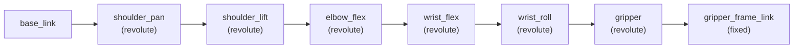

# Isaac Sim Environments

Details on the custom Isaac Lab environments for the SO-ARM101.

---

## Overview

Two Gymnasium-compatible environments are provided, built on NVIDIA's
Isaac Lab framework.  Both load the SO-ARM101 from its USD asset and run
inside the Isaac Sim physics engine.

| Environment | File | Task | Episode Length |
|---|---|---|---|
| **SoarmReachEnv** | `isaac_envs/soarm_reach_env.py` | Move EE to target | 5 s |
| **SoarmPickEnv** | `isaac_envs/soarm_pick_env.py` | Pick cube, place at target | 10 s |

---

## SO-ARM101 Robot Model

### Joint Configuration



### Actuator Properties

| Group | Joints | Stiffness | Damping | Effort Limit | Velocity Limit |
|---|---|---|---|---|---|
| Arm | shoulder_pan, shoulder_lift, elbow_flex, wrist_flex, wrist_roll | 80 | 4 | 30 Nm | 2 rad/s |
| Gripper | gripper | 80 | 4 | 10 Nm | 2 rad/s |

These approximate the STS3215 servos used in the real SO-ARM101.

---

## SoarmReachEnv

### Task

Move the end-effector (gripper_frame_link) to a randomly sampled 3D target
position within the robot's workspace.

### Observation Space

| Component | Dimension | Description |
|---|---|---|
| Joint positions | 6 | Current position of all 6 joints |
| Joint velocities | 6 | Current velocity of all 6 joints |
| Target position | 3 | XYZ target in world frame |
| **Total** | **15** | |
| Wrist camera (optional) | 224 x 224 x 3 | RGB image |

### Action Space

| Dimension | Range | Description |
|---|---|---|
| 6 | [-1, 1] | Scaled by `action_scale` (0.05 rad) and added to current joint positions |

### Reward

```
reward = -10 * distance_to_target + 5 * (distance < 2cm)
```

- Dense component proportional to end-effector distance from target
- Sparse bonus when within 2 cm (success threshold)

### Episode Termination

- **Success**: End-effector within 2 cm of target
- **Timeout**: 5 seconds (150 steps at 30 Hz policy rate)

### Domain Randomization

| Parameter | Range |
|---|---|
| Target X | 5 - 25 cm |
| Target Y | -15 - 15 cm |
| Target Z | 2 - 20 cm |
| Initial joint noise | Gaussian, sigma = 0.1 rad |

---

## SoarmPickEnv

Extends SoarmReachEnv with a manipulable cube.

### Task

Pick up a 3 cm cube from a random position and place it at a random target.

### Additional Observation

| Component | Dimension | Description |
|---|---|---|
| Cube position | 3 | XYZ in world frame |

Total observation: 15 (base) + 3 (cube) = **18**.

### Reward

Multi-phase reward:

```
reward = -5 * dist_ee_to_cube                              # reach
       + 2 * (grasped)                                     # grasp
       + 10 * (grasped AND cube_z > 5cm)                   # lift
       + 10 * (cube within 3cm of target)                  # place
```

### Additional Randomization

| Parameter | Range |
|---|---|
| Cube X | 13 - 25 cm |
| Cube Y | -10 - 10 cm |
| Cube Z | 1.5 cm (resting on table) |

### Scripted pick policy

`sim_data_collector.py --env pick` drives the arm with `ScriptedPick`: hover above the cube,
descend, close, lift, carry over the target, lower, release. It uses differential IK in pose
mode with the gripper pointing straight down.

How the grasp works:

| Setting | Value | Why |
|---|---|---|
| `solve_articulation_contact_last` | `True` (`SoarmReachEnvCfg.sim.physics`) | PhysX solves the jaw drive before the contacts by default, so the jaw pushes into the cube and squeezes it out. With the flag off, 1 of 10 episodes placed. |
| Wrist yaw | Lined up with the cube faces (nearest 90 deg) | If the jaws close on the cube at an angle, they catch its edges and the jaw stalls at 0.31-0.38 rad instead of 0.23-0.25. With the same physics, 11 of 20 placed without the alignment. |
| `GRASP_OFFSET` | 16 mm along -x of `gripper_frame_link` | From the jaw meshes, the fixed jaw's inner face is at x = +2..+4 mm, so a 3 cm cube touching it is centred at x = -13 mm. The extra 3 mm keeps the fixed jaw clear of the cube on the way down. |
| `GRASP_Z` | 10 mm | The jaw tips reach about 7 mm below `gripper_frame_link`. |
| Gripper goal | `GRIP_CONTACT - GRIP_SQUEEZE` = 0.24 - 0.14 = 0.10 rad | The jaw stalls on the 3 cm cube at 0.23-0.25 rad. The env's action clamp keeps the jaw target within 0.05 rad of its position, so the squeeze stays at about 4 N m or less. |
| Close phase | 45 steps | With 30 steps, the jaw was still closing when the lift began. |
| Joint-limit-aware IK | `respect_joint_limits` | Near the base (x < ~16 cm), top-down needs `wrist_flex` past its 95 deg limit. The pose IK kept asking for more, and the arm stalled 2-4 cm short, so the fixed jaw landed on the cube. Now joints at a limit are held there and the other joints fix the position. |
| `HOVER_TOL` | 4 mm | The fixed jaw clears the cube by ~3 mm, so a 1 cm hover tolerance could put it on top of the cube. |

You can override these settings with `--grip-contact`, `--grip-squeeze` and `--grasp-offset`.
Each episode line in the log shows the jaw angle at lift and the cube's peak height.

Measured success (issue #28): **20/20 placed** headless without cameras and 5/5 with cameras.
Before the joint-limit fix it was 15-18/20, with all misses on near-base cubes. With
`solve_articulation_contact_last=False` it was 1/10. The policy before #28 placed 0/5.

### Robot asset: importer-3.0 USD vs Isaac Lab `SO101_CFG` (issue #28)

We compared our USD with Isaac Lab's SO-101 SysID asset (`SO101_CFG` and `SO101_HIGH_PD_CFG`,
`Robots_Multiphysics/RobotStudio/so101_new_calib_SysID`, loaded from the NVIDIA asset server).
For the comparison we ran a scripted top-down grasp in `IsaacContrib-Stack-Cube-SO101-IK-Abs-v0`.

| | Our USD (`robot_description/usd/soarm101`) | Isaac Lab SysID USD / IK-Abs task |
|---|---|---|
| PhysX scene | `solve_articulation_contact_last=True`, bounce 0.01, friction corr. 6.25 mm (copied from the stack task) | same |
| Gripper drive | Implicit, k = 80, d = 4, effort 10 N m | USD: k = 1.19 N m/deg (68 per rad), d = 0.049 per deg, max force 3.35 N m. IK-Abs task: k = 17.8, d = 0.6, **effort 1 N m**, vel 2 rad/s |
| Arm solver iterations | 8 position / 0 velocity | 32 / 1 (USD physx variant); 8 / 0 in `SO101_CFG` |
| Jaw collision | Mesh convex decomposition (set at runtime in `SoarmPickEnv`) | Hand-made convex pieces per jaw |
| Materials | Cube friction 1.0 | Default |
| Prim layout | `Geometry/.../gripper_link/gripper_frame_link`, joints under `Physics/` | Flat links (`gripper`, `moving_jaw_so101_v1`) |

In our two A/B runs (3 and 5 episodes), every time the jaws landed on the 4 cm cube, the SysID
gripper held it through an 8 cm lift, stalled at 0.58 rad with only 1 N m. The other episodes
missed the cube: our open-loop script didn't calibrate where the cube sits in that asset's
gripper frame. We didn't debug this further.

**Decision: keep the importer-3.0 USD.** With the contact-last flag and the policy fixes, its
grasp holds (20/20 placed). It also needs no network asset server, and the rest of the stack (EE
link name, prim paths, cameras) is built on it. Two things are worth porting later if
sim-to-real fidelity matters:
- Real-servo gripper limits: about 3.35 N m. Our effort limit of 10 N m is higher than a real
  STS3215 servo can deliver.
- The SysID joint friction and armature.

---

## Simulation Parameters

| Parameter | Value |
|---|---|
| Physics dt | 1/120 s |
| Policy decimation | 4 (policy runs at 30 Hz) |
| Gravity | -9.81 m/s^2 |
| Solver iterations (pos) | 8 |
| PhysX scene | `solve_articulation_contact_last=True`, `bounce_threshold_velocity=0.01`, `friction_correlation_distance=0.00625` |
| Ground plane | Flat, at z=0 |
| Lighting | Dome light, 2000 lux |

---

## Camera Configuration

Both cameras come from the shared contract `isaac_envs/soarm_common/contract.py`
(`WRIST_CAMERA`, `OVERHEAD_CAMERA`), the same definitions `interactive_inference.py` uses.
Enable them with `use_wrist_camera=True` / `use_overhead_camera=True`; the images appear in
the observation dict as `wrist_rgb` / `overhead_rgb`.

| Parameter | Value |
|---|---|
| Resolution | 224 x 224, RGB uint8 |
| Sampling | 30 Hz (one image per control step) |
| Intrinsics | focal_length 1.93 mm, horizontal aperture 2.65 mm (69 deg horizontal FOV), near clip 1 cm |
| Wrist mount | under `gripper_frame_link` at (0.02, 0.04, -0.07) m: beside the gripper, 7 cm back from the tips, aimed between the jaws |
| Overhead | world (0.45, 0.40, 0.30) m looking at (0.19, 0, 0.03) |

See docs/CONFIG_ALIGNMENT.md for the full camera / key / control-rate contract.

---

## Third-person viewport camera

When running the environment with a **window** (GUI or livestream), the main viewport camera is configured to follow the robot so you can see the arm and target during testing.

- **Configuration**: `SoarmReachEnvCfg.viewer` uses Isaac Lab’s `ViewportCameraController` with `origin_type="asset_root"` and `asset_name="robot"`. The camera position (`eye`) and look-at point (`lookat`) are set so the robot base and workspace are in view. SoarmPickEnv inherits the same viewer.
- **When it applies**: Only when the env is run with a visible viewport (e.g. `render_mode="human"`). Headless data collection has no viewport; use the wrist-camera videos or the play script for visual verification.
- **How to see it**: Run the play script with a window or livestream (see below). If using the Docker container, connect with the [Isaac Sim WebRTC streaming client](https://docs.isaacsim.omniverse.nvidia.com/latest/installation/manual_livestream_clients.html) to view the simulation.

---

## Running Environments Standalone

**Play reach with third-person camera (GUI / livestream):**

```bash
# From host: run with livestream, then connect via WebRTC client
./scripts/play_reach.sh

# Or inside the container (with display or LIVESTREAM set):
/isaac-sim/python.sh /isaac_envs/play_reach.py
```

**Headless data collection:**

```bash
/isaac-sim/python.sh isaac_envs/sim_data_collector.py \
    --env reach --num-episodes 10 --output-dir /data/episodes
```

## Extending the Environments

To add a new task:

1. Copy `soarm_reach_env.py` as a starting point
2. Modify `_setup_scene()` to add new objects
3. Adjust `_get_observations()`, `_get_rewards()`, `_get_dones()`
4. Add domain randomization in `_reset_idx()`
5. Register with the data collector if needed
