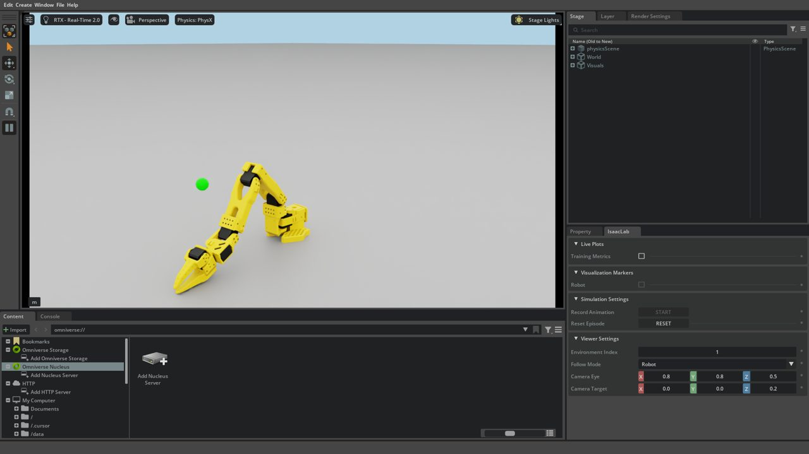

# F0: Set up Isaac Sim and stream it to Moonlight

> **Track:** Fasteners Part 1 (also Track A, tutorial 1) · **Time:** ~30 min once the image is
> built · **GPU:** headless and GUI over Moonlight · **Script:**
> [`tutorials/fasteners/part1/00_check_setup.py`](../../../tutorials/fasteners/part1/00_check_setup.py)

Every later tutorial assumes three things work: the Isaac Sim 6.2 / Isaac Lab 3.0 container
runs on your GPU, the SO-ARM101 robot asset loads and follows commands, and you can watch a
simulation over Moonlight. F0 sets these up and checks them with one script. It is the same
tutorial as tutorial 1 ("Isaac 6.x setup") of the real-to-sim track (#12), so do it once for
both tracks.

## What you'll learn

- How this repo runs Isaac Sim: the `soarm-isaac-sim` image, the `isaac-sim` compose service
  and its mounts, and `scripts/isaac.sh --headless | --gui`.
- How to stream the Isaac Sim window to any Moonlight client with the Sunshine container.
- The standard Isaac Lab 3.0 script skeleton: `add_launcher_args` → `launch_simulation` →
  build an environment → step it.
- How to read a tutorial checkpoint: a `[F0] PASS` line with versions, GPU and two numbers.

## Prerequisites

- Linux host with an NVIDIA RTX GPU (the reference runs use a 12 GB card) and driver ≥ 580.95.05
  ([ISAAC_VERSIONS.md](../../ISAAC_VERSIONS.md) lists tested drivers).
- Docker Engine ≥ 26 with Compose v2 and the NVIDIA Container Toolkit; your user can run
  `docker` (member of the `docker` group).
- `nvcr.io` login to pull the Isaac Sim base image (`docker login nvcr.io`, see
  [QUICKSTART.md](../../QUICKSTART.md#ngc-access-for-isaac-sim-container)).
- A [Moonlight](https://moonlight-stream.org/) client on a PC, Mac, tablet or phone on the same
  LAN or VPN.

## Set up

Run everything from the repository root.

**1. Check the GPU and container runtime.**

```bash
nvidia-smi                                     # driver version and GPU
docker run --rm --gpus all ubuntu nvidia-smi   # the same GPU, seen from a container
```

**2. Create your local config.** `docker/.env` holds local settings (IPs, Sunshine login)
and is never committed.

```bash
cp docker/.env.example docker/.env
```

Set `SUNSHINE_ALLOWED_SUBNETS` to your LAN/VPN subnets. Keep `ISAACSIM_VERSION=6.2.0.1` and
`ISAACLAB_REF` as they are.

**3. Build the Isaac Sim + Isaac Lab image** (about an hour the first time; it is tagged
`soarm-isaac-sim:6.2.0.1`):

```bash
cd docker && docker compose build isaac-sim && cd ..
```

**4. Check the robot asset.** The converted SO-ARM101 USD is committed at
`robot_description/usd/soarm101/soarm101.usda`. If it is missing, run
`./scripts/setup_robot_usd.sh`.

**5. Run the offline smoke test** (no GPU; checks files, script permissions, compose files):

```bash
bash scripts/smoke_test.sh
```

The data-format and import checks (sections 5–7) need `numpy`, `torch` and `pyarrow` in your
*host* Python. Without them those three checks fail, which is fine for F0. Everything else
should pass.

**6. Start the stream host.** One-time host setup (see
[SUNSHINE_STREAMING.md](../../SUNSHINE_STREAMING.md#host-prerequisites-one-time) for details):

```bash
sudo modprobe uinput && echo uinput | sudo tee /etc/modules-load.d/uinput.conf   # Moonlight input
sudo ./scripts/sunshine-firewall.sh install    # limit Sunshine to SUNSHINE_ALLOWED_SUBNETS
```

Then start Sunshine. It keeps running across reboots (`restart: unless-stopped`):

```bash
./scripts/sunshine.sh up
```

Open `https://<host-ip>:47990` (self-signed certificate) and create the web UI login. In
Moonlight, add the host by IP, type the PIN Moonlight shows into the web UI's **PIN** page,
and open **SO-ARM Isaac Desktop**. You should see an empty dark desktop.
`./scripts/sunshine.sh status` shows the container, X display and encoder state.

## The code

The check is
[`tutorials/fasteners/part1/00_check_setup.py`](../../../tutorials/fasteners/part1/00_check_setup.py)
(about 130 lines). It does not define any simulation itself. It reuses the repo's reach
environment, [`isaac_envs/soarm_reach_env.py`](../../../isaac_envs/soarm_reach_env.py), the same
one `scripts/play_reach.sh` shows. Open the script next to this page.

Inside the container the repo is mounted read-only. `tutorials/` is at `/tutorials`,
`isaac_envs/` at `/isaac_envs`, `robot_description/` at `/robot_description`. `data/` is at
`/data` and is writable: scripts put their outputs there.

## The code explained

### Parsing arguments and choosing headless or GUI

An Isaac Lab script parses its command line *before* the simulator starts.
`add_launcher_args` adds Isaac Lab's launcher options (`--device`, `--viz`, `--livestream`,
...). `scripts/isaac.sh --gui` sets `HEADLESS=0` in the container, but Isaac Lab 3.0 only opens
a window for a Kit visualizer, so the script selects `--viz kit` itself in that case. The
reach environment's config is built after launch, so `require_kit` tells the launcher up front
that this is a PhysX + RTX (Kit) job. Last, `/isaac_envs` goes on `sys.path` so the repo's
environments can be imported.

<!-- snippet: tutorials/fasteners/part1/00_check_setup.py#args -->
```python
import argparse
import os
import sys
import time

from isaaclab.app import add_launcher_args, launch_simulation

parser = argparse.ArgumentParser(description="F0: check the Isaac Sim / Isaac Lab / SO-ARM101 setup.")
parser.add_argument("--steps", type=int, default=100, help="Random-action steps to time after the motion check.")
parser.add_argument("--min-pan", type=float, default=0.3, help="Pass threshold: shoulder_pan travel (rad).")
add_launcher_args(parser)
args = parser.parse_args()

# scripts/isaac.sh --gui sets HEADLESS=0. Isaac Lab 3.0 opens a window only for a Kit visualizer.
if os.environ.get("HEADLESS") == "0" and not args.visualizer:
    args.visualizer = "kit"
gui = "kit" in str(args.visualizer or "")
# The env config is built inside the launched app, so tell the launcher it needs Kit (PhysX + RTX).
args.require_kit = True

# The repository's environments are mounted read-only at /isaac_envs in the isaac-sim container.
sys.path.insert(0, os.environ.get("SOARM_ISAAC_ENVS", "/isaac_envs"))
```

### Reading versions and the GPU

Modules that need the running simulator (`isaacsim.*`, `omni.*`) are imported only inside
the `launch_simulation` block. Isaac Sim reports its version from `/isaac-sim/VERSION`. Isaac
Lab's release comes from the `VERSION` file of its checkout. `isaaclab.__version__` is the
*extension* version (28.x), not the release.

<!-- snippet: tutorials/fasteners/part1/00_check_setup.py#versions -->
```python
import isaaclab
import torch
from isaacsim.core.version import get_version

core, prerelease = get_version()[:2]  # read from /isaac-sim/VERSION
# Isaac Lab's release is in the repo's VERSION file; isaaclab.__version__ is the extension version.
lab_version_file = os.path.join(os.environ.get("ISAACLAB_PATH", "/workspace/isaaclab"), "VERSION")
with open(lab_version_file, encoding="utf-8") as f:
    lab_release = f.read().strip()
props = torch.cuda.get_device_properties(0)
return {
    "isaac_sim": core,
    "isaac_sim_build": core + (f"-{prerelease}" if prerelease else ""),
    "isaac_lab": lab_release,
    "isaaclab_ext": isaaclab.__version__,
    "gpu": props.name.replace(" ", "_"),
    "vram_gb": f"{props.total_memory / 1024**3:.1f}",
}
```

### Building the reach environment

`SoarmReachEnv` is an Isaac Lab `DirectRLEnv`. Creating it spawns the robot USD under
`/World/envs/env_0/Robot`, a ground slab, a dome light and a target marker, then starts physics at
`dt = 1/120 s` with a policy step every 4 physics steps (30 Hz). `render_mode="human"` lets it
render to the open window. Observations are joint positions (6), velocities (6) and the target
position (3): `obs['policy']` has shape `(1, 15)`.

<!-- snippet: tutorials/fasteners/part1/00_check_setup.py#env -->
```python
cfg = SoarmReachEnvCfg()
env = SoarmReachEnv(cfg, render_mode="human" if gui else None)
obs, _ = env.reset()
print(f"[F0] reach env built: num_envs={env.num_envs} device={env.device} "
      f"obs={tuple(obs['policy'].shape)} actions={cfg.action_space}", flush=True)
```

### Proving that actions reach the robot

An action is 6 numbers in `[-1, 1]`, one per joint (5 arm joints and the gripper). The env
turns each into a joint-position target `current + action × 0.05 rad` and holds it for the 4
physics substeps. Pushing `shoulder_pan` (index 0) at full scale for 20 steps should rotate
the base by well over 0.3 rad. If actions were silently ignored (a real bug fixed in #20),
the travel would be ~0.

<!-- snippet: tutorials/fasteners/part1/00_check_setup.py#motion -->
```python
# Command +action_scale rad/step on shoulder_pan (action index 0) for 20 policy steps.
pan0 = env.robot.data.joint_pos.torch[0, 0].item()
action = torch.zeros(env.num_envs, cfg.action_space, device=env.device)
action[:, 0] = 1.0
for _ in range(20):
    env.step(action)
pan_travel = env.robot.data.joint_pos.torch[0, 0].item() - pan0
print(f"[F0] shoulder_pan travel after 20 steps: {pan_travel:+.3f} rad "
      f"(need >= {args.min_pan:.2f})", flush=True)
```

### Timing a short rollout

Random actions for `--steps` policy steps give a rough steps-per-second figure. You will
compare it across modes and environment counts later (F8). `DirectRLEnv.step` resets
finished episodes by itself, so the loop needs no reset logic.

<!-- snippet: tutorials/fasteners/part1/00_check_setup.py#timing -->
```python
t0 = time.perf_counter()
for _ in range(args.steps):
    action = 0.3 * torch.randn(env.num_envs, cfg.action_space, device=env.device)
    env.step(action)  # DirectRLEnv resets finished episodes by itself
steps_per_s = args.steps / (time.perf_counter() - t0)
```

### The checkpoint line

The verdict goes in one greppable line. The script exits 0 on PASS, 1 on FAIL. `sys.exit(1)`
is called inside the `with launch_simulation(...)` block so Isaac Lab hands the exit code
on to Kit.

<!-- snippet: tutorials/fasteners/part1/00_check_setup.py#verdict -->
```python
ok = pan_travel >= args.min_pan
verdict = "PASS" if ok else "FAIL"
print(f"[F0] {verdict} isaac_sim={info['isaac_sim']} isaac_lab={info['isaac_lab']} "
      f"gpu={info['gpu']} pan_travel={pan_travel:.3f}rad steps_per_s={steps_per_s:.1f} "
      f"mode={'gui' if gui else 'headless'}", flush=True)
```

In GUI mode the script then keeps the arm moving with random actions until you close the
window, so you can look at it.

## Run it

**Headless first** (no Sunshine needed). It is the quickest way to know that Isaac works:

```bash
./scripts/isaac.sh --headless /isaac-sim/python.sh /tutorials/fasteners/part1/00_check_setup.py
echo "exit code: $?"
```

The first start compiles shaders and fills the caches in the `isaac-cache-*` Docker volumes.
Expect several minutes once; after that the run takes under a minute.

**Then the GUI.** With Moonlight showing **SO-ARM Isaac Desktop**:

```bash
./scripts/isaac.sh --gui /isaac-sim/python.sh /tutorials/fasteners/part1/00_check_setup.py
```

The terminal prints `GUI mode: Isaac Sim will open on the Sunshine display.` and the Isaac Sim
window opens maximized in Moonlight. Close the window (or press `Ctrl+C` in the terminal) to
exit.

Options: `--steps N` (default 100, random steps to time), `--min-pan R` (default 0.3, pass
threshold in rad). Isaac Lab's launcher options also work, e.g. `--device cpu`.

`./scripts/play_reach.sh --gui` shows the same environment and runs until you close it. Use it
whenever you just want to look at the arm.

## Expected output

**Log.** Kit prints a lot. Filter with `2>&1 | grep '\[F0\]'`. On the reference machine
(12 GB reference GPU, headless; your `gpu=` and `vram_gb=` show your card):

```text
[F0] isaac_sim_build=6.2.0-rc.15 isaaclab_ext=28.0.0 gpu=<your_GPU> vram_gb=11.7
[F0] reach env built: num_envs=1 device=cuda:0 obs=(1, 15) actions=6
[F0] shoulder_pan travel after 20 steps: +0.487 rad (need >= 0.30)
[F0] PASS isaac_sim=6.2.0 isaac_lab=3.0.0 gpu=<your_GPU> pan_travel=0.487rad steps_per_s=83.4 mode=headless
```

The 6.2.0.1 image's `VERSION` file says `6.2.0-rc.15`. That is expected.
`OmniHub ... Hub failed to launch` warnings near the start are harmless.

**Screenshot.** In Moonlight you see the Isaac Sim window with the SO-ARM101 on a grey ground
slab under a dome light, the viewport camera following the robot from the front-right
(eye `(0.8, 0.8, 0.5)`), and a small sphere marking the reach target in front of it. First the base swings to
one side (the motion check), then the arm twitches under random actions.



In GUI mode the PASS line ends with `mode=gui`, for example
`[F0] PASS isaac_sim=6.2.0 isaac_lab=3.0.0 gpu=<your_GPU> pan_travel=0.487rad steps_per_s=7.5 mode=gui`.

**Checkpoint.** You are done with F0 when:

1. The headless run prints `[F0] PASS` and exits with code 0. `pan_travel` should be
   around 0.4–0.5 rad (≥ 0.30 required). `steps_per_s` depends on your GPU; note yours.
2. The GUI run shows the arm in Moonlight and prints `[F0] PASS ... mode=gui`.

## Try it

1. **Warm-up: break the check on purpose.** Run headless with `--min-pan 0.6`. Before
   running, predict the verdict and the exit code. Why can't the joint travel the full
   20 × 0.05 = 1.0 rad?

   <details><summary>Answer</summary>

   `[F0] FAIL ... pan_travel≈0.49rad`, exit code 1. The env sets each new target 0.05 rad
   ahead of the joint's *current* position, not of the previous target. The implicit PD
   actuator (stiffness 80, damping 4) closes only part of that gap in one 1/30 s policy step,
   so the joint gains about 0.024 rad per step instead of 0.05.

   </details>

2. **Headless vs GUI.** Run the script both ways with `--steps 300` and write down
   `steps_per_s`. Which is faster, and by roughly how much on your GPU?

   <details><summary>Answer</summary>

   Headless is faster. With a window, Kit also renders the viewport and Sunshine encodes it
   for Moonlight. Expect a clear drop in GUI mode: on the 12 GB reference GPU at 1920×1080, headless ran
   83.4 steps/s and GUI 7.5 steps/s, about 11× slower. The exact ratio depends on GPU and
   resolution. Keep these two numbers: F8 builds a full VRAM/FPS table from them. Use GUI to
   look and headless to produce data.

   </details>

3. **Core: four robots at once.** Copy the script to the writable data mount
   (`mkdir -p data/tutorials && cp tutorials/fasteners/part1/00_check_setup.py data/tutorials/f0_4envs.py`),
   make it build 4 environments, and run it as
   `./scripts/isaac.sh --headless /isaac-sim/python.sh /data/tutorials/f0_4envs.py`.
   Does the check still pass? How do `steps_per_s` and env-steps per second (`× num_envs`)
   compare with 1 env?

   <details><summary>Hint</summary>

   `isaac_envs/play_reach.py` sets the environment count. Two fields need it.

   </details>

   <details><summary>Answer</summary>

   After `cfg = SoarmReachEnvCfg()` add `cfg.num_envs = 4` and `cfg.scene.num_envs = 4`. The
   reported line now says `num_envs=4` and `obs=(4, 15)`. The motion check still passes,
   since every env receives the same pan action and the check reads env 0. Expect `steps_per_s`
   to drop much less than 4×, so env-steps per second (`steps_per_s × 4`) go up a lot. Part 2 is built on
   this: many environments per GPU, no window.

   </details>

4. **Stretch: move the camera.** In your copy, set
   `cfg.sim.default_visualizer_cfg.eye` so the GUI view looks at the arm from its left side
   at table height. Run with `--gui`. Which config class owns the viewport camera in Isaac
   Lab 3.0, and why does it do nothing in a headless run?

   <details><summary>Discussion</summary>

   For example, `cfg.sim.default_visualizer_cfg.eye = (0.0, 0.8, 0.15)`. The camera is set by
   `KitVisualizerCfg` (`SimulationCfg.default_visualizer_cfg`). Isaac Lab 3.0 removed
   `ViewerCfg`. A visualizer exists only when one is selected (`--viz kit`, which `--gui`
   implies here), so headless runs have no viewport to move. Cameras that record *data* are
   sensors (`CameraCfg`, TiledCamera) instead; F5 and F8 use those.

   </details>

## Troubleshooting

| Symptom | Cause / fix |
|---------|-------------|
| `ERROR: --gui needs the Sunshine display container` | Start it: `./scripts/sunshine.sh up`. |
| `soarm-sunshine is running but its X display is not ready` | `./scripts/sunshine.sh logs` and `./scripts/sunshine.sh xlog`. See [SUNSHINE_STREAMING.md](../../SUNSHINE_STREAMING.md#troubleshooting). |
| `can't open file '/tutorials/fasteners/...'` | Your `docker/docker-compose.yml` lacks the `../tutorials:/tutorials:ro` mount (older checkout). Update the repo. |
| `ModuleNotFoundError: No module named 'soarm_reach_env'` | `/isaac_envs` isn't mounted. Launch through `scripts/isaac.sh`, not a bare `docker run`. |
| `Failed to create shared memory named carb-RStringInternals-1` (GUI) | A crashed Kit left `carb-*` segments in the host `/dev/shm`. `--gui` clears them when no other Isaac container runs. Otherwise stop the other run, then `docker exec soarm-sunshine sh -c 'rm -f /dev/shm/carb-*'`. |
| Start seems stuck for minutes | First launch compiles shaders (cached afterwards). Check that the GPU is busy with `nvidia-smi`. |
| `[F0] FAIL ... pan_travel=0.000rad` | The robot ignores actions or did not load. Check that `robot_description/usd/soarm101/soarm101.usda` exists (`./scripts/setup_robot_usd.sh`) and look for errors above the `[F0]` lines. |
| PASS says `mode=headless` but you used `--gui` | The window needs `HEADLESS=0`. Make sure `--gui` comes *before* the command: `./scripts/isaac.sh --gui /isaac-sim/python.sh ...`. |
| Moonlight shows video but mouse/keyboard do nothing | `/dev/uinput` missing on the host: `sudo modprobe uinput`. |
| CUDA out of memory | Another job is using the GPU (training, another sim). `nvidia-smi`, stop it, retry. |

More: [TROUBLESHOOTING.md](../../TROUBLESHOOTING.md), [ERRORS_AND_SOLUTIONS.md](../../ERRORS_AND_SOLUTIONS.md).

## Next

Your stack works and you can watch it. F1 (planned, #30) generates the first fastener, an
ISO 4017 M6×20 hex bolt, and checks that it fits the SO-ARM101 jaw. Back to the
[tutorial index](../README.md).
