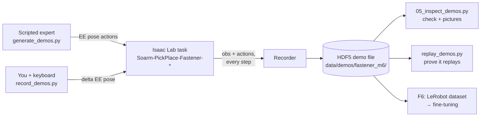
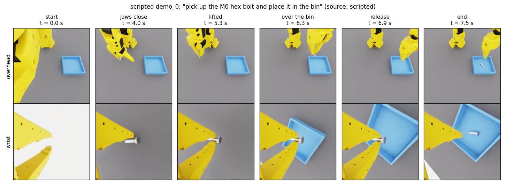
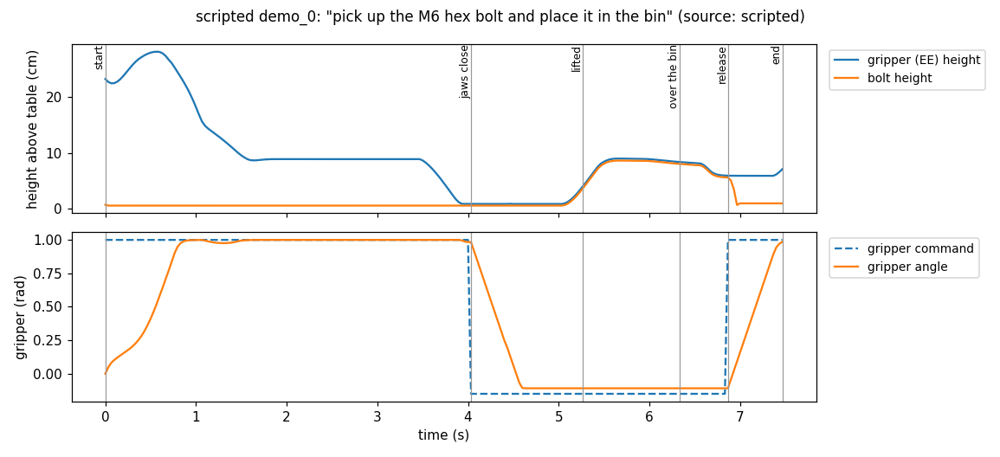
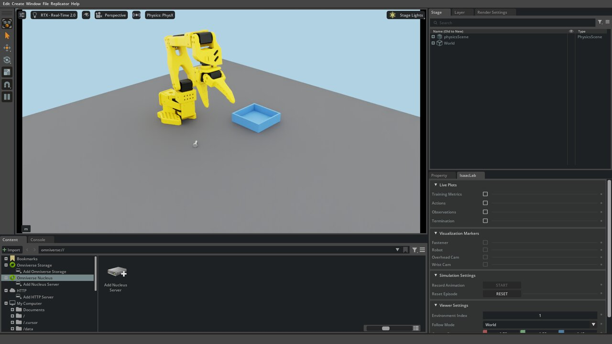
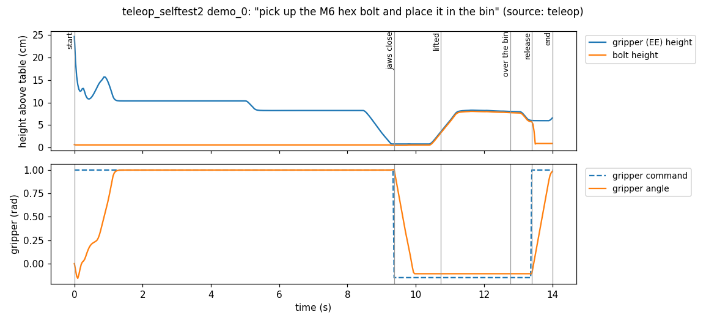

# F5: Record demonstrations

> **Track:** Fasteners Part 1 · **Time:** ~45 min (10 min of it is you at the keyboard) ·
> **GPU:** headless for scripted demos, GUI over Moonlight for teleop · **Script:**
> [`tutorials/fasteners/part1/05_inspect_demos.py`](../../../tutorials/fasteners/part1/05_inspect_demos.py)

A policy learns to pick the bolt by copying examples, so the first step of fine-tuning is
recording them. In this tutorial you make two kinds:
- **50 scripted demos.** The scripted expert from F4 makes these in about 7 minutes with no
  help from you. They give volume.
- **5 teleop demos.** You drive the arm with the keyboard through Moonlight. They teach you
  what the policy has to do, and they add the human variety that scripted demos lack.

Both kinds go into the same HDF5 file format. Then you check the files, look inside one demo,
and replay it. This page uses the demo tools from #33 (PR #49). F6 trains on the result.

## What you'll learn

- What a *demonstration* is in Isaac Lab: one episode of observations (camera images, joint
  state) paired step by step with the actions that were sent.
- How to generate scripted demos with many envs, and how to record your own with Isaac Lab's
  `record_demos.py` and the keyboard.
- How the keyboard maps onto the robot's axes, and what that looks like from the GUI camera.
- How to check a demo file, find the six key moments of a demo, and replay it to prove it is
  correct.

## Prerequisites

- Finished: [F0](F0_setup.md). The Isaac image runs, and Sunshine/Moonlight works with a
  keyboard (`sudo modprobe uinput` is done).
- F4's scripted expert is in the repo (`isaac_envs/soarm_tasks/expert.py`, PR #48). You can
  read F4's page later. This page only *runs* the expert.
- About 1 GB free under `data/` for every 50 demos with cameras.

## The big picture



Every demo is stored the same way whichever way it was made. Each step `t` pairs **what the
robot saw** before acting with **what it was told to do**:

| Stored as | Shape per step | Used for |
|---|---|---|
| `obs/overhead_rgb`, `obs/wrist_rgb` | 224×224×3 images | the policy's eyes |
| `obs/joint_pos` | 6 joint angles (rad) | the policy's sense of its own arm |
| `joint_pos_targets` | 6 joint targets (rad) | **the action the policy learns** (LeRobot `action`) |
| `ee_pose_actions` | gripper pose + gripper command | replay, debugging |
| attributes `prompt`, `seed`, `fastener`, `source` | one per demo | the language instruction; reproducing the demo |

The full layout is in
[`isaac_envs/soarm_tasks/demo_schema.py`](../../../isaac_envs/soarm_tasks/demo_schema.py).

## Activity 1: generate 50 scripted demos (headless, ~7 min)

Run from the repository root:

```bash
./scripts/isaac.sh --headless /isaac-sim/python.sh /isaac_envs/soarm_tasks/scripts/generate_demos.py \
    --num_demos 50 --num_envs 4 --seed 0 --dataset_file /data/demos/fastener_m6/scripted.hdf5
```

Four envs run in parallel. Each one keeps an episode once the bolt has rested in the bin for
10 steps, writes it, and resets. Drops and timeouts are thrown away. You should see a counter,
then a summary:

```text
[demos] 49/50 written  (failed 0, success rate 100%, 412s)
[demos] 50/50 written  (failed 0, success rate 100%, 415s)
[demos] DONE 50 demos written, 0 failed (success rate 100.0%) in 415s; 816.9 MB, 11380 steps; schema OK
```

> **Note:** Isaac Lab 3.0 scripts run headless unless a Kit visualizer is asked for, and they
> **don't accept `--headless`**. Passing it ends the run with `unrecognized arguments`.
> `scripts/isaac.sh --headless` only sets the container up for headless use.

## Activity 2: look inside a demo

Now check the file and draw one demo:

```bash
./scripts/isaac.sh --headless /isaac-sim/python.sh /tutorials/fasteners/part1/05_inspect_demos.py \
    --file /data/demos/fastener_m6/scripted.hdf5 --min-demos 50
```

```text
[F5] file=/data/demos/fastener_m6/scripted.hdf5 env=Soarm-PickPlace-Fastener-IK-Abs-v0 demos=50 successes=50 sources=['scripted'] size=857 MB
[F5] episode length: mean 7.6 s, min 7.3 s, max 8.0 s; prompts: ['pick up the M6 hex bolt and place it in the bin']
[F5] demo_0 moments (s): start 0.0, jaws close 4.0, lifted 5.3, over the bin 6.3, release 6.9, end 7.5
[F5] wrote /data/tutorials/F5/F5_scripted_frames.png
[F5] wrote /data/tutorials/F5/F5_scripted_timeline.png
[F5] PASS successes=50 (need >= 50) schema_problems=0
```

Open `data/tutorials/F5/F5_scripted_frames.png`. It shows what the policy will see at the six
key moments of the demo: the overhead camera on top, the wrist camera below.



The timeline (`F5_scripted_timeline.png`) shows the same demo as numbers:



**How to read it.**
- **Top panel.** The gripper (blue) comes down to about 1 cm and waits there while the jaws
  close. Then it rises, and the bolt (orange) rises *with* it. That is a held grasp.
- **Lower panel.** The gripper angle can't follow the "close" command (dashed, −0.15 rad) all
  the way. It stalls at about −0.11 rad because the 6 mm shank is between the jaws.

The script finds the six moments from those curves:

<!-- snippet: tutorials/fasteners/part1/05_inspect_demos.py#moments -->
```python
def key_moments(g: h5py.Group) -> dict[str, int]:
    """Step index of the six moments every pick-and-place demo goes through."""
    grip_target = g["ee_pose_actions"][:, 7]          # rad: > 0.5 open, < 0 close
    bolt = g["obs/fastener_pose"][:, :3]              # bolt position in the robot base frame (m)
    closed = grip_target < 0.5
    t_lift = int(np.argmax(bolt[:, 2] > 0.03))        # bolt 3 cm above the table
    starts = np.flatnonzero(closed[1:t_lift + 1] & ~closed[:t_lift]) + 1
    t_close = int(starts[-1]) if len(starts) else int(np.argmax(closed))  # the close that lifted it
    near_bin = np.all(np.abs(bolt[:, :2] - np.array(BIN.center)) < np.array(BIN.inner_size) / 2, axis=1)
    t_over = int(np.argmax(near_bin & (bolt[:, 2] > 0.03)))
    t_release = t_lift + int(np.argmax(~closed[t_lift:]))  # first "open" command after the lift
    return {"start": 0, "jaws close": t_close, "lifted": t_lift, "over the bin": t_over,
            "release": t_release, "end": len(grip_target) - 1}
```

The check at the top of `main()` uses the repo's schema validator, so a file that loads here
also loads in F6:

<!-- snippet: tutorials/fasteners/part1/05_inspect_demos.py#check -->
```python
    problems = S.validate(args.file)                   # layout, dims, images, attributes
    info = S.file_info(args.file)
    with h5py.File(args.file, "r") as f:
        demos = [f["data"][n] for n in S.episode_names(args.file)]
        successes = info["successes"]
        lengths = np.array([g.attrs["num_samples"] for g in demos])
        prompts = sorted({str(g.attrs.get("prompt", "")) for g in demos})
        print(f"[F5] file={args.file} env={info['env_name']} demos={info['demos']} successes={successes} "
              f"sources={info['sources']} size={info['bytes'] / 1e6:.0f} MB")
        print(f"[F5] episode length: mean {lengths.mean() / HZ:.1f} s, min {lengths.min() / HZ:.1f} s, "
              f"max {lengths.max() / HZ:.1f} s; prompts: {prompts}")
```

## Activity 3: drive the arm yourself (GUI, ~15 min)

### Learn the keys before you start

You steer the **gripper**, not the joints: the IK controller works out the joint angles.
Hold a key to move (3 mm per step, about 9 cm/s). Tap **K** to open or close the jaws.

The Isaac Sim window looks at the robot **from the front-right**, so the robot's axes don't
line up with your screen. **W moves the gripper toward you, not into the screen.** Here is
what each key does from the default camera:


| Key | Gripper moves | On screen (default camera) |
|---|---|---|
| **W** / **S** | away from / back toward the robot base (+x / −x) | down-right / up-left |
| **A** / **D** | toward / away from the bin (+y / −y) | up-right / down-left |
| **Q** / **E** | up / down (+z / −z) | up / down |
| **C** / **V** | turn the jaws about the vertical axis | — |
| **K** | open ↔ close the jaws (they start open) | — |
| **R** | give up on this attempt: reset without saving | — |
| **L** | stop all motion (if a key seems stuck) | — |

The jaws always point straight down, and Z/X/T/G (roll and pitch) do nothing on this task. The
full binding list is in the docstring of
[`isaac_envs/soarm_tasks/teleop.py`](../../../isaac_envs/soarm_tasks/teleop.py).

> **Tip:** to reach the bin, use **A**. In the picture W looks as if it points at the bin, but
> only because the camera is in front of the robot.

### Record five demos

1. **Start the stream host** (once): `./scripts/sunshine.sh up`. Open **SO-ARM Isaac Desktop**
   in Moonlight.
2. **Start recording.** Run this in a terminal on the host, not inside Moonlight:

   ```bash
   ./scripts/isaac.sh --gui /isaac-sim/python.sh /isaac_envs/soarm_tasks/scripts/with_soarm_tasks.py \
       /workspace/isaaclab/scripts/tools/record_demos.py --viz kit \
       --task Soarm-PickPlace-Fastener-IK-Rel-v0 --teleop_device keyboard \
       --dataset_file /data/demos/fastener_m6/teleop.hdf5 --num_demos 5
   ```

   The first start takes 2–5 minutes. Then the Isaac Sim window appears in Moonlight:

   

3. **Click once inside the 3D viewport.** Keys only reach Isaac Sim while its window has
   focus.
4. **Wait about 2 s.** After every reset the arm moves itself from the upright pose to a
   *ready pose* about 10 cm above the bolt area. Your keys move the target from there.
5. **Do the task**, slowly:
   1. **Line up.** Use W/S and A/D until the jaws are straight above the bolt's shank. Use
      C/V until the jaws open *across* the bolt.
   2. **Go down.** Hold **E** until the jaw tips are just above the table.
   3. **Grasp.** Tap **K** and wait half a second for the jaws to close.
   4. **Lift and carry.** Hold **Q** for about 1 s, then **A** until you are over the bin.
   5. **Release.** Tap **K**. The bolt drops in.
6. **Repeat.** When the bolt has rested in the bin for 10 steps, the episode is saved and the
   scene resets with a new bolt pose. The host terminal prints
   `Recorded 1 successful demonstrations.` If an attempt goes wrong (the bolt rolls away or
   you drop it outside the bin), press **R**: the attempt isn't saved. After the fifth success
   the app prints `All 5 demonstrations recorded.` and exits.

> **Can't use the keyboard right now?** `teleop_selftest.py` runs this exact recording path
> headless, with a scripted "person" pressing the keys:
>
> ```bash
> ./scripts/isaac.sh --headless /isaac-sim/python.sh /isaac_envs/soarm_tasks/scripts/teleop_selftest.py \
>     --dataset_file /data/demos/fastener_m6/teleop_selftest.hdf5 --num_demos 1
> ```

### Compare yourself with the expert

Run the inspector on your file:

```bash
./scripts/isaac.sh --headless /isaac-sim/python.sh /tutorials/fasteners/part1/05_inspect_demos.py \
    --file /data/demos/fastener_m6/teleop.hdf5 --min-demos 5
```

Here is a keyboard demo (from the self-test) next to the scripted one from Activity 2. Look at
the time axis:



| | Scripted (Activity 1) | Keyboard (self-test) |
|---|---|---|
| Length | 7.3–8.0 s | 14.0 s |
| Time before the jaws close | 4.0 s | 9.4 s |
| Carry (lifted → release) | 1.6 s | 2.7 s |

Human demos are slower and less regular, and they hesitate while lining up. That is normal.
The policy will learn from both kinds, so it sees more than one way of doing the task.

## Activity 4: prove the demos replay

A demo is only useful if replaying its actions does the same thing again. Isaac Lab's
`replay_demos.py` resets each env to the recorded starting state, sends the recorded actions,
and checks the task's success condition:

```bash
./scripts/isaac.sh --headless /isaac-sim/python.sh /isaac_envs/soarm_tasks/scripts/with_soarm_tasks.py \
    /workspace/isaaclab/scripts/tools/replay_demos.py --task Soarm-PickPlace-Fastener-IK-Abs-v0 \
    --dataset_file /data/demos/fastener_m6/scripted.hdf5 --num_envs 4 --validate_success_rate
```

```text
Successfully replayed: 50/50
```

The policy in F6 outputs **joint targets**, not gripper poses. So also replay the same demos on
the joint-space task. `demo_tools.py swap` copies the file with `joint_pos_targets` as the
actions:

```bash
./scripts/isaac.sh --headless bash -c '
  P=/isaac-sim/python.sh; S=/isaac_envs/soarm_tasks/scripts; D=/data/demos/fastener_m6
  $P $S/demo_tools.py swap $D/scripted.hdf5 $D/scripted_joint.hdf5 \
      --actions joint_pos_targets --task Soarm-PickPlace-Fastener-JointAbs-v0
  $P $S/with_soarm_tasks.py /workspace/isaaclab/scripts/tools/replay_demos.py \
      --task Soarm-PickPlace-Fastener-JointAbs-v0 --dataset_file $D/scripted_joint.hdf5 \
      --num_envs 4 --validate_success_rate'
```

```text
Successfully replayed: 50/50
```

Your keyboard file was recorded on the IK-Rel task, so its `actions` are key deltas. Replay it
on IK-Rel directly, or `swap` it first, as above.

## Expected output

**Checkpoint.**
- [ ] `[F5] PASS successes=50` on `scripted.hdf5`
- [ ] `[F5] PASS successes=5` on `teleop.hdf5`
- [ ] `Successfully replayed: 50/50` on IK-Abs **and** on JointAbs

Our reference run (12 GB GPU):

| Check | Result |
|---|---|
| `generate_demos.py`, 4 envs, cameras | 50/50 written, 0 failed, 415 s, 817 MB |
| Replay on IK-Abs / on JointAbs | 50/50 / 50/50 |
| Keyboard path (self-test) | 1/1 recorded; it replays 1/1 on IK-Rel, IK-Abs and JointAbs |

## Try it

1. **Warm-up: predict, then observe.** Run the inspector with `--demo 7`. Before you look,
   predict whether "jaws close" will come earlier or later than in demo 0, and why it can
   differ at all when the expert is the same.

   <details><summary>Answer</summary>

   It differs by a few tenths of a second. Each episode starts with a different random bolt
   pose (position ±5 cm, any yaw). The expert travels a different distance, and it turns the
   wrist by a different angle to get across the shank. The episode lengths in the
   `[F5] episode length` line (7.3–8.0 s) show the same spread.

   </details>

2. **Core: find the grasp in the numbers.** In demo 0, the gripper angle settles at about
   −0.11 rad while it holds the bolt. Using `obs/gripper_pos`, find how that value compares
   with a jaw that closes on *nothing*. Hint: make a copy of the script in `data/tutorials/`
   and print `g["obs/gripper_pos"][t_close:t_close + 30]`.

   <details><summary>Answer</summary>

   Closing on nothing ends at the commanded −0.15 rad. A held 6 mm shank stops the jaw at
   about −0.11 rad. The task's `grasped` check uses this gap: the gripper must be between
   −0.12 and 0.5 rad. The margin is only about 0.01 rad, which is why F12 tunes it per
   fastener size.

   </details>

3. **Stretch: does variety matter?** Generate a second scripted file with `--seed 1`, and look
   at the overhead frames of a few demos from each file. In what ways do your teleop demos
   differ from *every* scripted demo? What could a policy trained only on scripted demos fail
   to learn?

   <details><summary>Discussion</summary>

   Scripted demos always use the same approach height, speed and wrist angle choice, and they
   never correct themselves. Human demos hesitate, overshoot and recover. A policy that has
   only seen perfect approaches may not know what to do after a small miss. That is one
   reason the plan mixes both kinds, and why Part 2 adds Mimic-generated variety.

   </details>

## Troubleshooting

| Symptom | Cause / fix |
|---------|-------------|
| `error: unrecognized arguments: --headless` | Isaac Lab 3.0 scripts have no `--headless` flag. Drop it: they run headless by default. |
| Keys do nothing in the Isaac Sim window | Click inside the 3D viewport first, so the window has focus. If Moonlight's mouse doesn't work either, run `sudo modprobe uinput` on the host (see [F0](F0_setup.md#troubleshooting)). |
| The arm moves the "wrong" way | See the key picture above: the camera looks from the front-right, so W moves toward you. |
| The arm keeps drifting after you let go | A key-release was lost over the network. Press **L** to stop all motion. |
| The gripper stops short of where you want it | The target can't run more than 3 cm ahead of the gripper, or leave the 0.05–0.40 m × ±0.30 m workspace box. Wait for the arm to catch up. |
| The jaws close but the bolt slides out on the lift | You grasped too close to the head or the tip, or across the head. Grasp the shank about 1 cm from the head, with the jaws across the bolt (C/V). |
| `Unable to synchronously open file (unable to lock file ...)` | Another run still has the file open, often a container left over from a timed-out run. Check with `docker ps`, then stop it with `docker rm -f <name>`. |
| `RuntimeError: The expanded size of the tensor (8) must match ... (7)` in `replay_demos.py` | You replayed a keyboard (IK-Rel, 7-wide actions) file on IK-Abs. Replay it on IK-Rel, or `swap --actions ee_pose_actions` first. |
| The replay success rate is below 100 % | The scene is not deterministic enough on your setup, or the file was recorded with a different task config. Run `demo_tools.py info FILE` and compare its `env` with `--task`. |

General problems (Kit start, carb shared memory, Moonlight black screen) are in
[F0's troubleshooting](F0_setup.md#troubleshooting) and
[TROUBLESHOOTING.md](../../TROUBLESHOOTING.md).

## Next

You now have demos that replay: 50 scripted and 5 of your own. Next, turn them into a LeRobot
dataset and fine-tune a policy on it.
Next: [F6: Fine-tune ACT and SmolVLA](F6_finetune.md). Back to the [tutorial index](../README.md).
