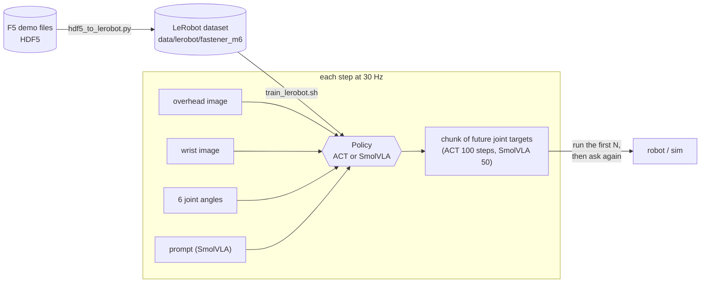
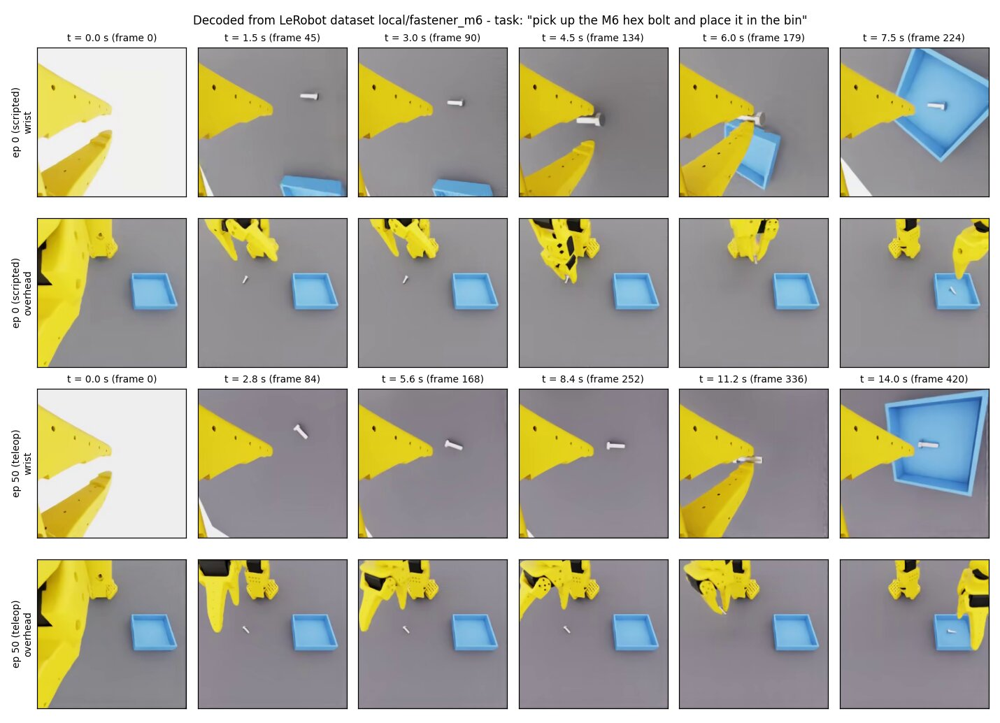
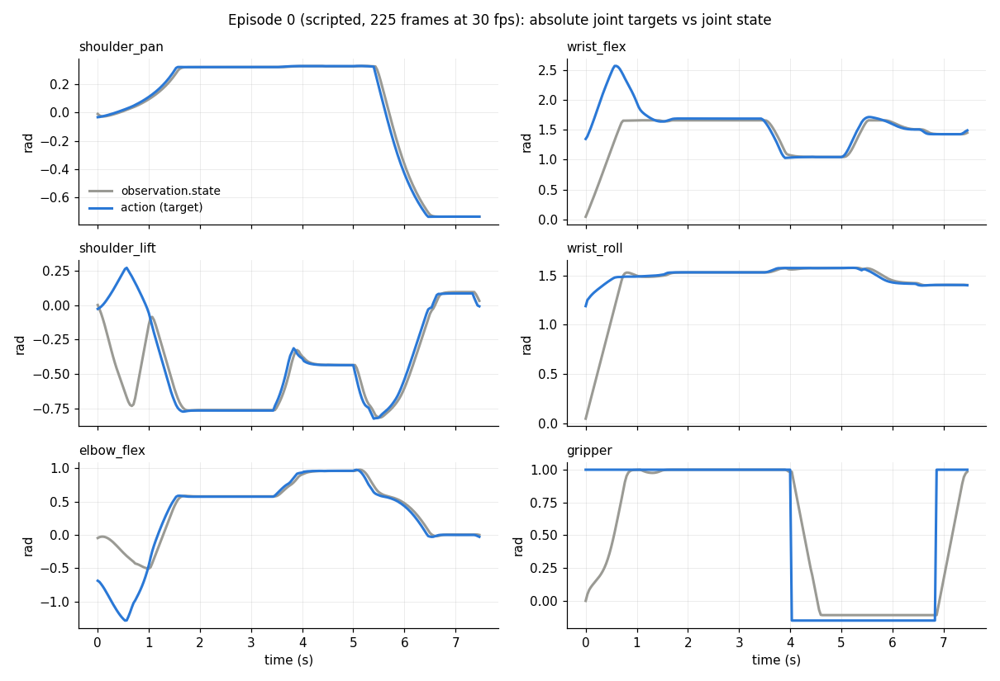
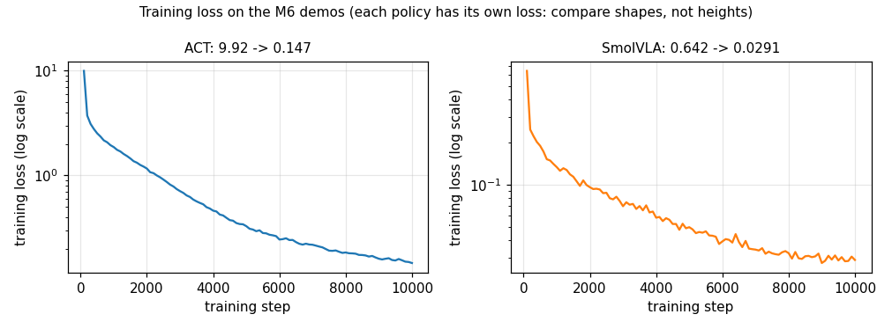
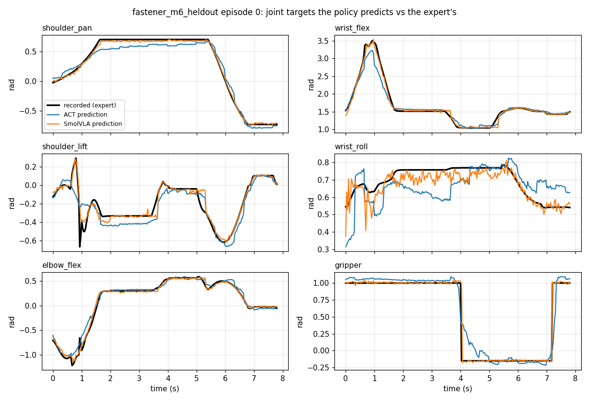
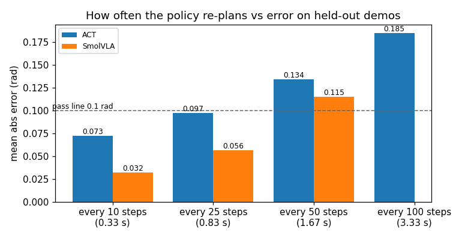
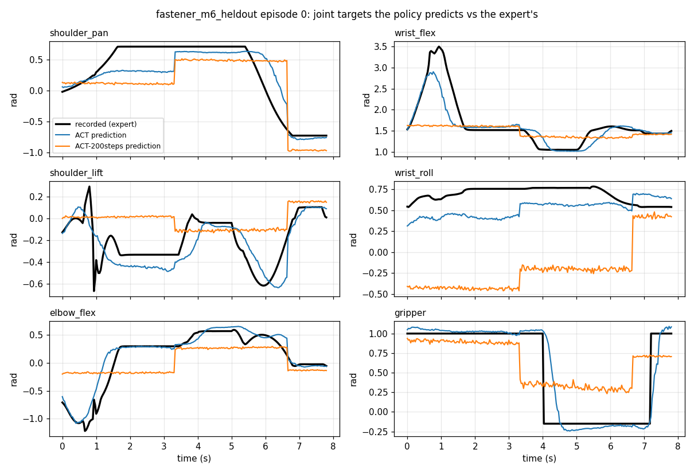

# F6: Fine-tune ACT and SmolVLA

> **Track:** Fasteners Part 1 · **Time:** ~3 h, mostly waiting (ACT trains in 17 min, SmolVLA
> in 2 h 16 min) · **GPU:** headless; SmolVLA needs about 5.5 GB free, ACT about 2 GB · **Script:**
> [`tutorials/fasteners/part1/06_check_policy.py`](../../../tutorials/fasteners/part1/06_check_policy.py)

In F5 you recorded demos of the arm putting an M6 bolt in the bin. Now you teach a neural
network to do the same thing from what it *sees*. You will train two policies on the same
51 demos and compare them:
- **ACT**: a 52 M-parameter transformer trained from scratch.
- **SmolVLA**: a 450 M-parameter vision-language-action model. You fine-tune it from
  `lerobot/smolvla_base`, so it also reads the prompt *"pick up the M6 hex bolt and place it in
  the bin"*.

You then check both on five demos they have never seen. This page uses the LeRobot dataset
conversion (#34, PR #50) and the LeRobot training container (#35).

## What you'll learn

- How a demo file becomes a LeRobot v3.0 dataset, and how to prove that nothing got lost on
  the way.
- What a policy actually learns: from images, joint state and (for SmolVLA) the prompt, to the
  next *chunk* of joint targets.
- How to fine-tune both policies on one GPU, and how to read their logs and loss curves.
- How to measure a policy on held-out demos without a simulator, and why *how often it
  re-plans* matters as much as how long you train.

## Prerequisites

- Finished: [F5](F5_record_demos.md). It leaves `data/demos/fastener_m6/scripted.hdf5` (and
  your `teleop.hdf5`).
- The LeRobot image is built once: `cd docker && docker compose --profile train-lerobot build lerobot`.
  That's about a 3.5 GB pull. [LEROBOT_TRAINING.md](../../LEROBOT_TRAINING.md) has the details.
- **No Isaac Sim running.** Training needs the GPU to itself. `train_lerobot.sh` refuses to
  start while an Isaac container is up.
- About 8 GB free under `data/`: the checkpoints are 2.4 GB for ACT and about 5 GB for
  SmolVLA.

## The big picture



Training is **supervised imitation**. At every frame of every demo, the policy predicts the
expert's next joint targets, and the loss measures how far off it was. A policy doesn't predict
one action; it predicts a **chunk**: the next 100 (ACT) or 50 (SmolVLA) steps. The robot runs
the first *N* of them, then asks again. Activity 4 shows why *N* matters.

## Activity 1: turn the demos into a LeRobot dataset (~5 min, CPU)

LeRobot doesn't read Isaac Lab's HDF5 files. `hdf5_to_lerobot.py` copies each demo into a
LeRobot v3.0 dataset:
- joint state, joint targets and the prompt go into parquet tables
- the two cameras go into AV1 videos

This is the whole mapping:

<!-- snippet: training/scripts/hdf5_to_lerobot.py#features -->
```python
def lerobot_features() -> dict:
    """LeRobot feature spec: 6-D state and action (rad, contract joint order), one video per
    contract camera. LeRobot adds timestamp, frame_index, episode_index, index and task_index."""
    joints = {"names": list(C.JOINT_NAMES)}
    features = {
        C.DATASET_STATE_KEY: {"dtype": "float32", "shape": (C.NUM_JOINTS,), **joints},
        C.DATASET_ACTION_KEY: {"dtype": "float32", "shape": (C.ACTION_DIM,), **joints},
    }
    for cam in C.CAMERAS:  # observation.images.wrist, observation.images.overhead
        features[cam.dataset_key] = {
            "dtype": "video",
            "shape": (cam.height, cam.width, 3),
            "names": ["height", "width", "channels"],
        }
    return features


# HDF5 dataset (demo_schema key) -> LeRobot feature
HDF5_TO_LEROBOT = {
    S.JOINT_POS: C.DATASET_STATE_KEY,
    S.JOINT_POS_TARGETS: C.DATASET_ACTION_KEY,
    **{f"obs/{cam.obs_key}": cam.dataset_key for cam in C.CAMERAS},
}
```

The frame loop is just as short. Each kept step becomes one `add_frame`, and each demo becomes one
`save_episode` (`keep_frames` only matters with `--max-idle-frames`, see
[F7](F7_run_policy.md#the-idle-frame-trap)):

<!-- snippet: training/scripts/hdf5_to_lerobot.py#frames -->
```python
        keep = keep_frames(arrays[S.JOINT_POS_TARGETS], arrays[S.JOINT_POS], max_idle)
        num_frames = int(keep.sum())
        for t in np.flatnonzero(keep):
            frame = {feature: arrays[key][t] for key, feature in HDF5_TO_LEROBOT.items()}
            frame[C.DATASET_STATE_KEY] = frame[C.DATASET_STATE_KEY].astype(np.float32)
            frame[C.DATASET_ACTION_KEY] = frame[C.DATASET_ACTION_KEY].astype(np.float32)
            frame["task"] = demo["prompt"]  # one task string per episode
            dataset.add_frame(frame)
        dataset.save_episode()  # encodes the videos, writes parquet + episode metadata
```

**Run it.** The LeRobot container sees the repo's `data/` folder as `/workspace/data`:

```bash
cd docker
docker compose --profile train-lerobot run --rm -e NVIDIA_VISIBLE_DEVICES=void lerobot \
    python /training/scripts/hdf5_to_lerobot.py \
        /workspace/data/demos/fastener_m6/scripted.hdf5 /workspace/data/demos/fastener_m6/teleop.hdf5 \
        --output-root /workspace/data/lerobot/fastener_m6 --repo-id local/fastener_m6
```

```text
episode   0  scripted.hdf5:demo_0   scripted   225 frames  (   4.8 s)
episode   1  scripted.hdf5:demo_1   scripted   228 frames  (   9.5 s)
...
```

Our 50 scripted demos plus 1 keyboard demo became **51 episodes and 11,801 frames in 252 s**.
The 817 MB of HDF5 shrank to a **30 MB** dataset, because video compresses well.

**Prove that nothing got lost.** The validator reads the dataset back the way training will.
It compares every state and action value with the HDF5, and decoded video frames with the
original images:

```bash
docker compose --profile train-lerobot run --rm -e NVIDIA_VISIBLE_DEVICES=void lerobot \
    python /training/scripts/validate_lerobot_dataset.py /workspace/data/lerobot/fastener_m6 \
        --hdf5-dir /workspace/data/demos/fastener_m6 --expect-episodes 51
```

```text
[PASS] codebase_version: v3.0
[PASS] fps: 30 (contract 30)
...
[PASS] state/action = HDF5 joint_pos / joint_pos_targets: max abs diff 0 rad
[PASS] observation.images.wrist decoded vs HDF5 (64 frames): MAE mean 1.65, median 1.57, max 2.41 (0-255 scale, tolerance 4.0)
[PASS] observation.images.overhead decoded vs HDF5 (64 frames): MAE mean 1.79, median 1.80, max 2.21 (0-255 scale, tolerance 4.0)
[PASS] decoded frame t is closest to HDF5 frame t (not t-1 / t+1): 9 comparisons with a moving scene

OK
```

Numbers are copied exactly (difference 0). Images are off by about 2 grey levels out of 255,
which is video compression. A swapped camera would show up as 30–89, and a time shift would
fail the last check.

**What the policy will see.** These frames were decoded *from the dataset*, not from the HDF5.
They show a scripted episode (top two rows) and the keyboard episode (bottom two):



**What the policy must output.** For each joint, the blue line is the target the policy has to
predict (`action`). The grey line is the joint angle it is given (`observation.state`):



The two lines mostly sit on top of each other: the arm follows its targets closely. There is
one exception. In the first second, the targets jump while the arm is still at its upright
reset pose, and the arm catches up about 1 s later. The policy has to learn to "lead" the arm
like this.

## Activity 2: train ACT (17 min)

Run from the repository root:

```bash
./scripts/train_lerobot.sh --policy act --dataset data/lerobot/fastener_m6 \
    --steps 10000 --batch 8 --save-freq 2500 --job-name act_fastener_m6_10k
```

LeRobot prints a summary, then one line every 100 steps:

```text
INFO ... dataset.num_frames=11801 (12K)
INFO ... dataset.num_episodes=51
INFO ... num_learnable_params=51597190 (52M)
...
INFO ... step:10K smpl:80K ep:346 epch:6.78 loss:0.147 grdn:15.742 lr:1.0e-05 ... smp/s:83 mem_gb:1.2
INFO ... Checkpoint policy after step 10000
INFO ... End of training
```

How to read a log line:

| Field | Meaning | Ours at the end |
|---|---|---|
| `loss` | training loss (ACT: L1 on the actions + a small KL term) | 9.9 → **0.147** |
| `epch` | how many times it has seen every frame | 6.8 (LeRobot suggests 5–10) |
| `smp/s` | training speed in frames per second | 83 |
| `mem_gb` | GPU memory in use | **1.2 GB** |

The checkpoints land in `data/checkpoints/act_fastener_m6_10k/checkpoints/{002500,005000,007500,010000}/`.
`last` points to the newest one.

## Activity 3: fine-tune SmolVLA (2 h 16 min)

SmolVLA starts from `lerobot/smolvla_base`, which was pre-trained on many community SO-100
datasets. Its camera inputs are called `camera1..3`. `--rename-map` tells it which of our
cameras is which. The top-down view goes to `camera1`, as in LeRobot's own SO-101 example:

```bash
./scripts/train_lerobot.sh --policy smolvla --dataset data/lerobot/fastener_m6 \
    --steps 10000 --batch 16 --save-freq 2500 --job-name smolvla_fastener_m6_10k \
    --rename-map '{"observation.images.overhead":"observation.images.camera1","observation.images.wrist":"observation.images.camera2"}'
```

```text
INFO ... Auto-scaling LR scheduler: num_training_steps (10000) < num_decay_steps (30000). Scaling warmup: 1000 → 333, decay: 30000 → 10000 (scale factor: 0.333)
INFO ... num_learnable_params=99880992 (100M)
INFO ... num_total_params=450046176 (450M)
...
INFO ... step:10K smpl:160K ep:691 epch:13.56 loss:0.029 ... smp/s:20 mem_gb:4.42
```

Only 100 M of the 450 M parameters are trained. The vision-language backbone stays frozen,
which is why SmolVLA fits in 4.4 GB. It is **4× slower** than ACT per frame (20 against
83 frames/s), so 10k steps at batch 16 take 2 h 16 min. Use the wait to read ahead.

**Compare the loss curves.** TensorBoard shows them live
(`tensorboard --logdir data/checkpoints`). The check script in Activity 4 also draws them:



The two losses are computed differently. ACT uses L1 on the actions; SmolVLA uses a
flow-matching error. So **compare the shapes, not the heights**. Both are still falling slowly
at 10k steps. A low training loss only shows that the policy has learned the demos it was
shown. Activity 4 tests it on demos it hasn't seen.

| | ACT | SmolVLA |
|---|---|---|
| Parameters trained / total | 52 M / 52 M | 100 M / 450 M |
| Batch, steps, epochs | 8, 10k, 6.8 | 16, 10k, 13.6 |
| Speed | 83 frames/s | 20 frames/s |
| Wall time | **17 min** | **2 h 16 min** |
| GPU memory (`mem_gb`) | 1.2 GB | 4.4 GB |
| Checkpoints (4 of them) | 2.4 GB | ~5 GB |

## Activity 4: test on demos the policy has never seen

**Make a held-out set.** The training demos used `--seed 0`. Five new demos with `--seed 100`
have bolt poses the policies have never seen:

```bash
./scripts/isaac.sh --headless /isaac-sim/python.sh /isaac_envs/soarm_tasks/scripts/generate_demos.py \
    --num_demos 5 --num_envs 1 --seed 100 --dataset_file /data/demos/fastener_m6_heldout/scripted_seed100.hdf5
cd docker
docker compose --profile train-lerobot run --rm -e NVIDIA_VISIBLE_DEVICES=void lerobot \
    python /training/scripts/hdf5_to_lerobot.py /workspace/data/demos/fastener_m6_heldout/scripted_seed100.hdf5 \
        --output-root /workspace/data/lerobot/fastener_m6_heldout --repo-id local/fastener_m6_heldout
```

### The code

`06_check_policy.py` loads a checkpoint *with the processors saved next to it*. These are the
same normalization and camera renames used in training, so you don't repeat `--rename-map`:

<!-- snippet: tutorials/fasteners/part1/06_check_policy.py#load -->
```python
def load(path: str):
    """Policy plus the processors saved next to it (same normalization and camera names as in training)."""
    with open(os.path.join(path, "config.json")) as f:
        policy_type = json.load(f)["type"]                     # "act", "smolvla", ...
    policy = get_policy_class(policy_type).from_pretrained(path).to(args.device).eval()
    if args.n_action_steps:                                    # how much of each chunk runs before re-planning
        policy.config.n_action_steps = args.n_action_steps
    with open(os.path.join(path, "train_config.json")) as f:
        rename_map = json.load(f).get("rename_map") or {}      # e.g. overhead -> camera1 for SmolVLA
    pre, post = make_pre_post_processors(policy.config, pretrained_path=path, preprocessor_overrides={
        "device_processor": {"device": args.device},
        "rename_observations_processor": {"rename_map": rename_map}})
    return policy, pre, post
```

Then it plays each held-out episode into the policy one frame at a time, as a robot would.
`select_action` hands back one action per call, and asks the network for a new chunk only when
the current one runs out:

<!-- snippet: tutorials/fasteners/part1/06_check_policy.py#rollout -->
```python
@torch.no_grad()
def predict_episode(policy, pre, post, ds: LeRobotDataset, ep: int) -> tuple[np.ndarray, np.ndarray]:
    """Predicted and recorded actions for every frame of one episode, fed in order like a live robot."""
    start = ds.meta.episodes["dataset_from_index"][ep]
    end = ds.meta.episodes["dataset_to_index"][ep]
    policy.reset()                                             # empty the action queue (chunking)
    predicted, recorded = [], []
    for i in range(start, end):
        frame = ds[i]                                          # images, state, task string, recorded action
        obs = {k: v for k, v in frame.items() if k.startswith("observation.")}
        obs["task"] = frame["task"]
        action = post(policy.select_action(pre(obs)))          # normalized -> radians
        predicted.append(action.squeeze(0).float().cpu().numpy())
        recorded.append(frame["action"].numpy())
    return np.array(predicted), np.array(recorded)
```

> **Note:** this is an *open-loop* test. The policy sees the expert's images, not the result of
> its own actions, so small errors can't snowball. It's a quick, simulator-free check that the
> policy has learned the right thing. F7 runs it closed-loop in Isaac Sim, which is the real test.

### Run it

```bash
docker compose --profile train-lerobot run --rm lerobot python /tutorials/fasteners/part1/06_check_policy.py \
    --policy ACT=/workspace/data/checkpoints/act_fastener_m6_10k \
    --policy SmolVLA=/workspace/data/checkpoints/smolvla_fastener_m6_10k \
    --n-action-steps 10 --sweep 10,25,50,100
```

```text
[F6] held-out dataset /workspace/data/lerobot/fastener_m6_heldout: 5 episodes, 1139 frames, task ['pick up the M6 hex bolt and place it in the bin']
[F6] ACT: chunk 100 steps, re-plans every 10 steps (0.33 s)
[F6] ACT: mean abs error 0.073 rad (4.2 deg) over 1139 frames, 153 frames/s on cuda
[F6] ACT per joint (rad): shoulder_pan 0.055, shoulder_lift 0.078, elbow_flex 0.054, wrist_flex 0.056, wrist_roll 0.121, gripper 0.072
[F6] SmolVLA: chunk 50 steps, re-plans every 10 steps (0.33 s)
[F6] SmolVLA: mean abs error 0.030 rad (1.7 deg) over 1139 frames, 26 frames/s on cuda
[F6] SmolVLA per joint (rad): shoulder_pan 0.016, shoulder_lift 0.025, elbow_flex 0.022, wrist_flex 0.027, wrist_roll 0.064, gripper 0.024
...
[F6] PASS ACT=0.073rad SmolVLA=0.030rad (need <= 0.1); lowest error: SmolVLA
```

### Read the result

`F6_open_loop.png` shows held-out episode 0. The black line is the expert's target, and the
coloured lines are what each policy predicted, frame by frame:



Things to notice:
- **SmolVLA (orange) almost hides the black line.** That includes the fast wrist flick in the
  first second and the exact moment the gripper closes (4.0 s).
- **ACT (blue) has the right shape but lags and offsets.** Look at shoulder_pan between 2 and
  5 s, where it turns less than the expert, and at the gripper closing about 0.3 s late.
- **`wrist_roll` is the hardest joint for both.** It depends on the bolt's yaw, which is a few
  pixels in the overhead image.

### Why re-planning matters

`--sweep` reruns the same checkpoints and changes only *N*, how many steps of each chunk run
before the policy is asked again:



Same weights, **2.5× less error**, just from asking more often. A chunk is a plan made from
one moment's view. The longer you follow it blindly, the further reality drifts from it. With
ACT's default (`n_action_steps = 100`, re-plan every 3.3 s) the picture looks like this. Notice
the staircase: the predictions jump only when a new chunk starts, at 0, 3.3 and 6.7 s.



Re-planning more often costs compute. ACT checks 153 frames/s on this GPU, so re-planning
every step would still be real-time. SmolVLA checks 26 frames/s with N = 10, and one chunk
takes about 0.27 s. F7 uses this when it runs the policy live.

## Expected output

**Checkpoint.**
- [ ] The validator ends with `OK` (state/action diff 0, frame MAE ≤ 4)
- [ ] Both training runs end with `End of training`, and a `checkpoints/last/` exists for each
- [ ] `[F6] PASS`: mean error ≤ 0.1 rad on the held-out demos with `--n-action-steps 10`

Our reference run (12 GB GPU):

| Check | ACT | SmolVLA |
|---|---|---|
| Training loss, step 100 → 10k | 9.92 → 0.147 | 0.642 → 0.029 |
| Held-out error, re-plan every 10 steps | **0.073 rad (4.2°)** | **0.030 rad (1.7°)** |
| … every 25 / 50 steps | 0.097 / 0.134 | 0.056 / 0.115 |
| … every 100 steps (ACT's default) | 0.185 | — (chunk is 50) |

SmolVLA *samples* its actions (flow matching), so its numbers change by about ±0.005 rad from
run to run (we saw 0.029–0.032). ACT is deterministic.

## Try it

1. **Warm-up: predict, then observe.** Check the step-2500 ACT checkpoint
   (`--policy ACT2500=/workspace/data/checkpoints/act_fastener_m6_10k/checkpoints/002500/pretrained_model`).
   Before you run it, predict whether its held-out error will be closer to the 10k checkpoint
   (0.073) or to an untrained guess, and why.

   <details><summary>Answer</summary>

   We measured **0.091 rad**, close to the 10k checkpoint's 0.073 and already under the
   0.1 rad pass line. The loss falls fastest in the first few thousand steps (see the loss
   curve), so most of the skill is learned early. The remaining 7,500 steps polish it, mainly
   the gripper (0.133 → 0.072 rad) and `wrist_flex`. For comparison, a 200-step ACT scores
   0.29 rad with N = 100.

   </details>

2. **Core: how much does the prompt matter?** SmolVLA reads the text instruction. Make a copy
   of the script in `data/tutorials/`, replace `obs["task"] = frame["task"]` with a different
   instruction (for example `"wave at the camera"`), and rerun SmolVLA alone. Does the error
   change?

   <details><summary>Hint</summary>

   The script folder is mounted read-only. Copy it to `data/tutorials/06_check_policy_prompt.py`
   (which the container sees as `/workspace/data/tutorials/...`) and run that path instead.

   </details>

   <details><summary>Answer</summary>

   We measured **0.060 rad with "wave at the camera" against 0.030 rad with the real prompt**:
   the error doubles. It still moves towards the bolt and the bin, because the images drive most
   of the motion. But the text is part of its input, and every training demo had the same
   sentence, so any other sentence is something it has never seen. Prompts start to *carry
   information* in Part 2 (F9), when the same scene can mean "M5 to bin A" or "M8 to bin B".

   </details>

3. **Stretch: fewer demos.** Reconvert with only 10 of the 50 scripted demos. Copy them out
   first with h5py, or keep 10 with `demo_tools.py`. Retrain ACT (it's quick) and check it. How
   does the held-out error scale with the number of demos? What does that suggest for Part 2's
   Mimic step (F10), which makes about 1,000 demos?

   <details><summary>Discussion</summary>

   We haven't measured this one, so treat it as a prediction to test. With fewer demos, ACT
   sees fewer bolt poses, so expect its error on new poses to go up. Expect the biggest jump on
   the joints that depend on where the bolt lies and how it is turned (`shoulder_pan`,
   `wrist_roll`). If that holds, it is the case for generating many varied demos rather than
   training longer on the same few.

   </details>

## Troubleshooting

| Symptom | Cause / fix |
|---------|-------------|
| `train_lerobot.sh` stops with `Not enough free GPU memory for batch N` | Something holds the GPU, often an Isaac Sim container. `nvidia-smi` shows it; stop it (`docker ps`, then `docker rm -f <name>`). On a small card, pass a smaller `--batch`. |
| `CUDA out of memory` while training SmolVLA | Something else is on the GPU, or the batch is too big. Batch 16 needs about 4.5 GB and batch 32 about 7.8 GB; batch 64 doesn't fit (see [LEROBOT_TRAINING.md](../../LEROBOT_TRAINING.md)). |
| SmolVLA errors about missing image features (`observation.images.camera1`) | You left out `--rename-map`, or misspelled a key. The keys are `observation.images.overhead` and `observation.images.wrist`. |
| `FileNotFoundError: ... /workspace/data/...` | The LeRobot container mounts `data/` at `/workspace/data`, not `/data` as in the Isaac container. |
| `can't open file '/tutorials/fasteners/...'` in the lerobot container | Your `docker/docker-compose.yml` lacks the `../tutorials:/tutorials:ro` mount on the `lerobot` service (older checkout). Update the repo. |
| `ModuleNotFoundError: No module named 'matplotlib'` | The lerobot image is older than this page. Rebuild it: `docker compose --profile train-lerobot build lerobot`. |
| `[F6] FAIL` with errors around 0.13–0.19 rad | Check the `re-plans every` line. Without `--n-action-steps 10`, ACT runs its whole 100-step chunk. |
| The validator fails on frame MAE | The video was re-encoded with other settings, or a camera key was swapped. MAE 30+ means the wrong camera. |

General problems are in [F0's troubleshooting](F0_setup.md#troubleshooting),
[LEROBOT_TRAINING.md](../../LEROBOT_TRAINING.md) and [TROUBLESHOOTING.md](../../TROUBLESHOOTING.md).

## Next

You have two trained policies, and you know which tracks the expert better on new bolt poses.
Next, run them live, closed-loop in Isaac Sim, where the policy has to cope with its own
mistakes.
Next: [F7: Run your policy in Isaac Sim](F7_run_policy.md). Back to the [tutorial index](../README.md).
