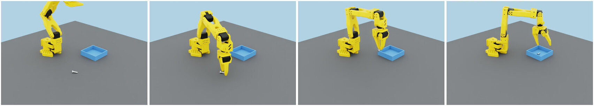
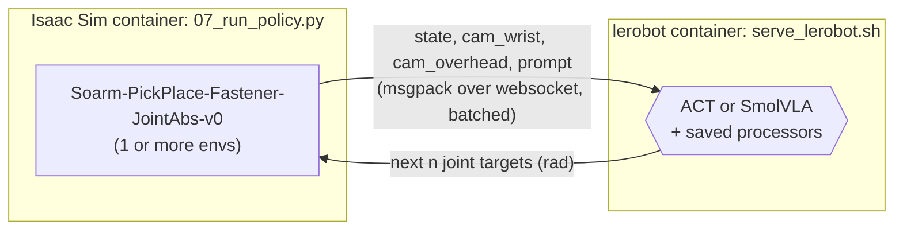
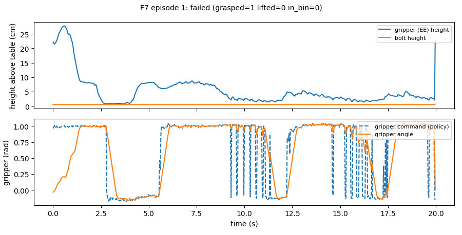
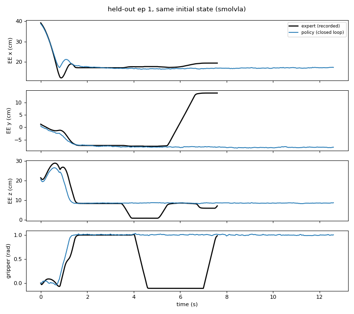
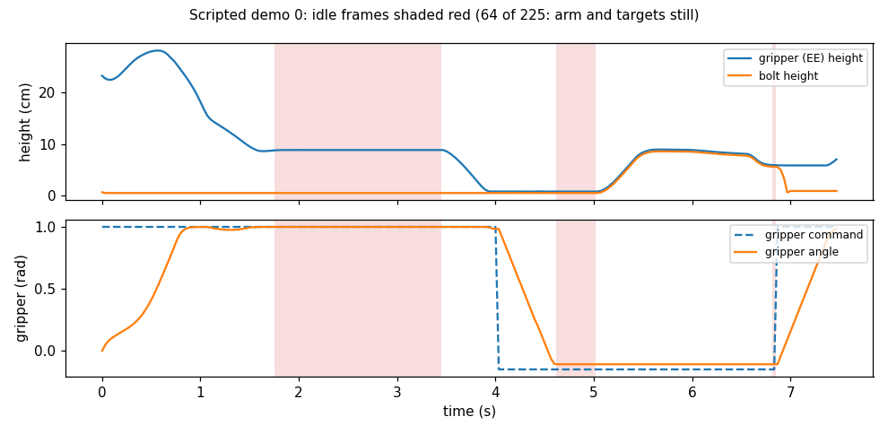
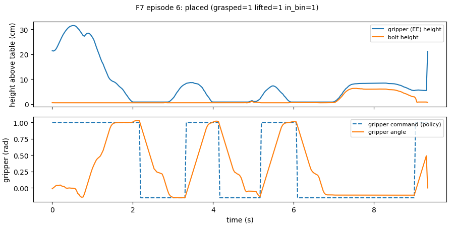
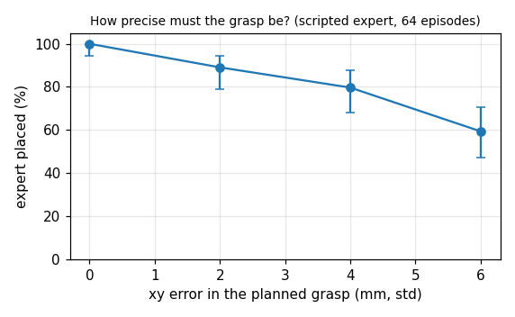
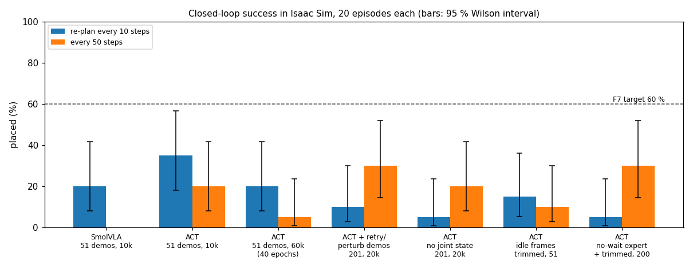

# F7: Run your policy in Isaac Sim

> **Track:** Fasteners Part 1 (milestone) · **Time:** ~1 h to run; the debugging activities
> take longer · **GPU:** any NVIDIA GPU (on the 12 GB reference GPU the Isaac
> Sim scene plus the policy server used under 3 GB; the server falls back to the CPU when there is no room) · **Script:**
> [`tutorials/fasteners/part1/07_run_policy.py`](../../../tutorials/fasteners/part1/07_run_policy.py)

In F6 your policies predicted the expert's joint targets almost exactly on demos they had
never seen. But there the policy only *watched*: every frame came from a recording, so a small
mistake could never snowball. Here it *drives*. Isaac Sim shows it the result of its own
actions, and you count how often the bolt really ends up in the bin.



*Our final SmolVLA policy, closed-loop in the Isaac Sim GUI: approach, grasp, carry, placed.
It places the bolt in 75 % of episodes on new bolt poses.*

This is where imitation learning gets honest. Our first closed-loop runs placed the bolt in only
**2–7 out of 20** episodes, even though open-loop error was tiny. This page walks through the
debugging that got it to **75 %**. Each activity is a tool you will reuse for any policy:
- traces of what the policy did;
- a same-state comparison with the expert;
- a check of your demonstrations for *idle frames*;
- a measurement of how precise the task really is.

It uses the policy server from #36 (PR #52).

## What you'll learn

- How to serve a LeRobot checkpoint (`scripts/serve_lerobot.sh`) and drive Isaac Sim with it,
  closed-loop, in the GUI and headless.
- How to read a closed-loop result: success rate, its 95 % Wilson interval, and the failure
  stages (grasped, lifted, in bin).
- How to find *why* a policy fails, from per-episode traces and a same-state comparison with
  the expert.
- Two traps that open-loop numbers hide: **idle frames** in the demos, and the **precision**
  the task needs. How to fix the data for the first one.

## Prerequisites

- Finished: [F6](F6_finetune.md). It leaves `data/checkpoints/act_fastener_m6_10k` and
  `smolvla_fastener_m6_10k`.
- The Isaac image rebuilt after #36 (`cd docker && docker compose build isaac-sim`), so it has
  `msgpack` for the client.
- The lerobot image rebuilt after #36 (`docker compose --profile train-lerobot build lerobot`),
  so the server has `websockets`.

## The big picture



Every control step, each env that has run out of actions sends what it sees to the server. It
gets back the next *n* joint targets and plays them one per step. *n* is how often the policy
re-plans (F6). The simulation waits for the server, so the result doesn't depend on how fast
your GPU is.

## Activity 1: start the policy server

```bash
./scripts/serve_lerobot.sh --checkpoint data/checkpoints/act_fastener_m6_10k --detach
curl -s http://127.0.0.1:8000/healthz        # prints OK once the policy is loaded
docker logs soarm-lerobot-server | grep lerobot_policy_server
```

```text
... lerobot_policy_server loaded act in ...s: {"server": "lerobot", "policy_type": "act", ..., "device": "cuda", "chunk_size": 100, "n_action_steps": 10, ...}
... lerobot_policy_server GPU memory after load: 0.19 GB allocated
... lerobot_policy_server LeRobot policy server listening on ws://0.0.0.0:8000
```

`--device auto`, the default, puts the policy on the GPU when there is room next to whatever
already runs there, and otherwise on the CPU. On the 12 GB reference GPU, SmolVLA uses
1.2 GB, ACT less, and the interactive Isaac Sim scene about 1.25 GB.
[INTERACTIVE_INFERENCE.md](../../INTERACTIVE_INFERENCE.md#serving-a-fine-tuned-lerobot-policy-act--smolvla)
has the details, plus how to drive the arm through the ROS 2 bridge instead.

## Activity 2: run it closed-loop

**Watch one episode** in Moonlight (`./scripts/sunshine.sh up` first):

```bash
./scripts/isaac.sh --gui /isaac-sim/python.sh /tutorials/fasteners/part1/07_run_policy.py --episodes 3
```

**Measure** 20 episodes on 4 envs. The server answers all 4 in one batched request:

```bash
./scripts/isaac.sh --headless /isaac-sim/python.sh /tutorials/fasteners/part1/07_run_policy.py \
    --episodes 20 --num_envs 4 --trace /data/tutorials/F7_act
```

```text
[F7] server: act on cuda, chunk 100, re-plans every 10 steps; /workspace/data/checkpoints/act_fastener_m6_10k/checkpoints/last/pretrained_model
[F7] task Soarm-PickPlace-Fastener-JointAbs-v0, 4 env(s), seed 200, prompt 'pick up the M6 hex bolt and place it in the bin'
[F7] episode  1 (env 0): PLACED in 5.6 s  grasped=1 lifted=1 in_bin=1
[F7] episode  2 (env 2): PLACED in 6.4 s  grasped=1 lifted=1 in_bin=1
...
[F7] episode  5 (env 1): failed in 20.0 s  grasped=1 lifted=1 in_bin=0 timed out
[F7] episode  6 (env 1): PLACED in 5.5 s  grasped=1 lifted=1 in_bin=1
[F7] episode  7 (env 2): failed in 20.0 s  grasped=0 lifted=0 in_bin=0 timed out
...
[F7] grasped 15/20, lifted 8/20, in bin 7/20
[F7] 933 policy requests, round trip median 16 ms (p95 18 ms); 86 s simulated in 247 s (real-time factor 0.35)
[F7] FAIL placed 7/20 = 35% (95% Wilson CI 18-57%), need >= 60%
```

### The code

The client is a thin websocket loop. The part that matters is the step: ask for actions for
the envs that have none left, then step every env with its next action:

<!-- snippet: tutorials/fasteners/part1/07_run_policy.py#step -->
```python
            need = [i for i in range(n) if not queues[i]]      # envs that ran out of actions
            if need:
                request = {
                    C.POLICY_STATE_KEY: obs["policy"]["joint_pos"][need].cpu().numpy().astype(np.float32),
                    C.POLICY_IMAGES_KEY: {cam.policy_key: obs["images"][cam.obs_key][need].cpu().numpy()
                                          for cam in C.CAMERAS},
                    C.POLICY_PROMPT_KEY: [prompts[i] for i in need],
                }
                if args.n_action_steps:
                    request["n_action_steps"] = args.n_action_steps
                t0 = time.perf_counter()
                actions = client.infer(request)[C.POLICY_ACTIONS_KEY]   # (len(need), H, 6), rad
                latencies.append(time.perf_counter() - t0)
                for j, i in enumerate(need):
                    queues[i] = list(actions[j])
            action = np.stack([q.pop(0) for q in queues])
            if not args.raw_gripper:
                for i in range(n):
                    action[i, 5], grip_closed[i] = snap_gripper(float(action[i, 5]), grip_closed[i])
            action = torch.tensor(action, device=u.device)
            obs, _, terminated, truncated, _ = env.step(action)
```

Every bolt pose comes from `--seed 200`. The training demos used seed 0, and F6's held-out
demos seed 100.

> **Note:** 20 episodes give a wide interval. 7/20 means "somewhere between 18 % and 57 %".
> Compare policies only when their intervals barely overlap, or run more episodes.
> `--num_envs 4` makes that cheap.

## Activity 3: read the traces

`--trace DIR` saves every episode as a `.npz` file and a timeline. Here is a failed SmolVLA
episode:



What to look for:
- **When did the jaws close, and how high was the gripper?** The expert closes at 0.8 cm.
- **Where did the gripper angle stop?** −0.11 rad means it is holding the 6 mm shank;
  −0.15 rad means it closed on nothing. Values between 0 and 0.5 mean it was commanded
  half-closed.
- **What did it do after a miss?** Here it never saw a recovery in the demos, so it wanders
  and the gripper command chatters.

Across our first policies, three failure types dominated:

| Failure | What the trace shows |
|---|---|
| Hovers for ever | The gripper sits at 8–9 cm until the 20 s timeout. The jaws never close. |
| Closes too high | The jaws close with the gripper at 2–4 cm, above the bolt. |
| Closes on nothing | The gripper is at the right height, but the jaws end at −0.15 rad: a few mm off in xy. |

## Activity 4: compare with the expert from the same state

Traces show *what* happened, not *where it went wrong*. For that, put the policy in exactly
the situation the expert faced:
1. Reset the sim to a held-out demo's recorded initial state, which is what `replay_demos.py`
   does.
2. Let the policy drive from there.
3. Plot both trajectories.

Our SmolVLA, from the starting state of held-out episode 1:



The policy copies the expert **to the millimetre** until the hover point, then never goes
down. It isn't a precision problem. It doesn't know *when* to go.

### The idle-frame trap

Look at a scripted demo again, this time with every *idle* frame shaded. These are frames
where neither the joint targets nor the joint angles move:



64 of 225 frames are idle, and **28 % of all frames** across the 50 demos. During the hover
(1.7–3.4 s) the expert waits for the IK to settle within 4 mm before it descends. The camera
images are practically identical for 50 frames, but the label changes from "stay" to "go
down" at the end. A policy that only sees images and joint angles can't tell those frames
apart. Most of them say "stay", so closed-loop it stays.

Two fixes, which you need together:
1. **Trim idle frames** when converting. `hdf5_to_lerobot.py --max-idle-frames 2` keeps the
   first 2 frames of every idle stretch:

   <!-- snippet: training/scripts/hdf5_to_lerobot.py#idle -->
   ```python
   def keep_frames(actions: np.ndarray, states: np.ndarray, max_idle: int, eps: float = 0.005) -> np.ndarray:
       """Which frames to keep when idle stretches are trimmed (``--max-idle-frames``).

       A frame is idle when neither the joint targets nor the joint angles moved more than ``eps``
       rad since the previous frame, e.g. while the expert hovers and waits to line up. In such a
       stretch the camera images hardly change, yet the label switches from "stay" to "go down" at
       its end, so a policy cannot tell when to go and, closed-loop, hovers for ever. Keep only the
       first ``max_idle`` frames of every idle stretch (all frames when ``max_idle`` < 0).
       """
       keep = np.ones(len(actions), dtype=bool)
       if max_idle < 0:
           return keep
       run = 0
       for t in range(1, len(actions)):
           idle = np.abs(actions[t] - actions[t - 1]).max() < eps and np.abs(states[t] - states[t - 1]).max() < eps
           run = run + 1 if idle else 0
           keep[t] = run <= max_idle
       return keep
   ```

2. **Don't make the expert wait.** Trimming also removed the wait in which the expert finished
   lining up. With only fix 1, our policy went down at once and closed at the right height,
   but a few mm off. Let the expert start descending as soon as it is within 1.5 cm
   (`--set hover_tol=0.015`). It keeps correcting xy on the way down, where the camera images
   change. The expert itself still succeeds 64/64 that way.

### Teach recoveries

A policy imitating a perfect expert never sees a mistake, so it has no idea what to do after
one. `generate_demos.py` can make the expert miss on purpose, get pushed off target, and retry:

<!-- snippet: isaac_envs/soarm_tasks/expert.py#recovery_params -->
```python
    # Corrective demonstrations (F7): all off by default, so the plain expert is unchanged.
    retry: bool = False              # after a missed grasp (bolt still down when lifting), go back to hover
    max_retries: int = 2
    miss_prob: float = 0.0           # chance per episode that the first grasp aims miss_offset off the bolt
    miss_offset: float = 0.03        # m, along the bolt axis: the jaws close on nothing, a retry follows
    perturb_prob: float = 0.0        # chance per episode of one goal displacement during hover/descend
    perturb_range: tuple[float, float] = (0.01, 0.025)  # m, sideways size of the displacement
    perturb_steps: int = 6           # control steps the goal stays displaced; the expert then corrects
    pose_noise: float = 0.0          # m, std of an xy error in the bolt position the grasp is planned from
```

```bash
./scripts/isaac.sh --headless /isaac-sim/python.sh /isaac_envs/soarm_tasks/scripts/generate_demos.py \
    --num_demos 200 --num_envs 4 --seed 3 --retry --miss_prob 0.15 --perturb_prob 0.5 --set hover_tol=0.015 \
    --dataset_file /data/demos/fastener_m6/fluid.hdf5
```

```text
[demos] DONE 200 demos written, 0 failed (success rate 100.0%) in 1432s; 2872.9 MB, 37696 steps; schema OK
```

Then convert with `--max-idle-frames 2` (35,517 frames are kept) and retrain as in F6.
Policies trained on these demos learned to retry. In this ACT episode it misses twice, reopens,
lines up again, and places the bolt on the third try:



## Activity 5: how precise must the policy be?

After those fixes, almost every failure was "closes on nothing" at the right height: an xy
error. How big an error can the task take? Give the scripted expert a noisy bolt position and
measure:

```bash
for nz in 0 0.002 0.004 0.006; do
  ./scripts/isaac.sh --headless /isaac-sim/python.sh /isaac_envs/soarm_tasks/scripts/scripted_eval.py \
      --episodes 64 --num_envs 16 --no-cameras --set pose_noise=$nz
done
```



A policy needs to grasp within about **4 mm** to place the bolt 80 % of the time. The M6
shank is 6 mm across. In the 224×224 overhead image the whole bolt is about 11 pixels long, so
most of that precision has to come from the wrist camera.

## Activity 6: put it together

The fixes only pay off with a policy precise enough to use them. SmolVLA was 2.5× more
accurate than ACT open-loop (F6). Here is the whole recipe, starting from the improved demos of
Activity 4:

```bash
# 1. convert with idle frames trimmed
cd docker && docker compose --profile train-lerobot run --rm -e NVIDIA_VISIBLE_DEVICES=void lerobot \
    python /training/scripts/hdf5_to_lerobot.py /workspace/data/demos/fastener_m6/fluid.hdf5 \
        --output-root /workspace/data/lerobot/fastener_m6_fluid --max-idle-frames 2 && cd ..
# 2. fine-tune SmolVLA for 20k steps (9 epochs; 4 h 28 min on the 12 GB reference GPU)
./scripts/train_lerobot.sh --policy smolvla --dataset data/lerobot/fastener_m6_fluid --steps 20000 \
    --save-freq 10000 --job-name smolvla_fastener_m6_fluid_20k \
    --rename-map '{"observation.images.overhead":"observation.images.camera1","observation.images.wrist":"observation.images.camera2"}'
# 3. serve it (re-plan every 10 steps, the default) and run it
./scripts/serve_lerobot.sh --checkpoint data/checkpoints/smolvla_fastener_m6_fluid_20k --detach
./scripts/isaac.sh --headless /isaac-sim/python.sh /tutorials/fasteners/part1/07_run_policy.py \
    --episodes 40 --num_envs 4 --seed 300
```

```text
[F7] server: smolvla on cuda, chunk 50, re-plans every 10 steps; /workspace/data/checkpoints/smolvla_fastener_m6_fluid_20k/...
[F7] grasped 40/40, lifted 32/40, in bin 30/40
[F7] 1264 policy requests, round trip median 296 ms (p95 328 ms); 118 s simulated in 697 s (real-time factor 0.17)
[F7] PASS placed 30/40 = 75% (95% Wilson CI 60-86%), need >= 60%
```

> **Note:** start the server with the default `--n-action-steps 10`. The same checkpoint
> re-planning every 25 steps placed 11/20, and every 50 steps failed the episode we watched.

## Results

Everything we tried, measured the same way (re-planning every 10 steps, 4 envs; seed 200, plus
a confirmation run on seed 300):



`07_run_policy.py` snaps the gripper command to open or closed (`snap_gripper`, below). The
earliest ACT runs predate that and used the raw value. Snapping on its own made no measurable
difference.

<!-- snippet: tutorials/fasteners/part1/07_run_policy.py#gripper -->
```python
GRIP_OPEN, GRIP_CLOSED = 1.0, -0.15     # rad: the two gripper targets in every demo (ExpertParams)
CLOSE_BELOW, OPEN_ABOVE = 0.3, 0.55     # hysteresis around the midpoint (0.425 rad)


def snap_gripper(cmd: float, closed: bool) -> tuple[float, bool]:
    """Binary gripper: the demos only ever command open or closed, but a regression policy
    averages near the switch and outputs in-between values, i.e. half-closed jaws that cannot
    hold a bolt. Snap to open/closed, with hysteresis so it does not flicker at the threshold."""
    closed = cmd < CLOSE_BELOW if not closed else cmd < OPEN_ABOVE
    return (GRIP_CLOSED if closed else GRIP_OPEN), closed
```

What the experiments show:
- **Open-loop accuracy doesn't predict closed-loop success.** SmolVLA was 2.5× more accurate
  than ACT in F6, yet no better here. Always test closed-loop.
- **Training longer doesn't fix bad data.** ACT at 40 epochs (loss 0.045) did no better than at
  6.8 epochs (loss 0.147). On the *fixed* data it mattered: SmolVLA placed 2/20 after 10k steps
  and 13/20 after 20k.
- **Fixing the data changes *how* a policy fails** before it changes *how often*:
  - With the original demos, it hovered for ever or closed too high.
  - With idle frames trimmed, it closed at the right height.
  - With recovery demos added, it retried after a miss.
  - Only then did a more precise policy (SmolVLA) turn that into success: 72 % over 60 episodes.
- **20 episodes can't separate these variants.** The intervals overlap. Part 2's evaluation
  harness (#37) runs hundreds of episodes on many envs.

**Milestone met.** The F7 target is ≥ 60 % placed. SmolVLA on the improved demos placed
13/20 (65 %) on seed 200 and 30/40 (75 %, 95 % interval 60–86 %) on new poses (seed 300):
**43/60 = 72 %** overall. It grasped 60/60. The remaining failures are bolts that slip out
during the lift or carry (lifted 48/60, placed 43/60). Part 2 adds variety (more sizes, bins,
Mimic, #38) and a larger evaluation (#37).

## Expected output

**Checkpoint.**
- [ ] `curl -s http://127.0.0.1:8000/healthz` prints `OK`, and the server log shows your
  checkpoint and device.
- [ ] `07_run_policy.py` finishes 20 episodes and prints a `[F7] PASS/FAIL` line with a
  Wilson interval.
- [ ] You can name the dominant failure type of your policy from its traces.

`[F7] PASS` needs ≥ 60 % placed. Your first F6 checkpoints will most likely FAIL, as ours did.
The recipe in Activity 6 passes (we measured 65 % and 75 %).

## Try it

1. **Warm-up: re-plan interval, closed-loop.** Run ACT with `--n-action-steps 1`, then 10 and
   50. Before you run, use F6's open-loop sweep to predict which works best.

   <details><summary>Answer</summary>

   We measured 0/20 at 1, 7/20 at 10 and 4/20 at 50. Open-loop, re-planning every step would
   look best, but closed-loop ACT then switches between different plans at every step and
   dithers. (ACT's own fix for this is *temporal ensembling*: averaging the overlapping chunks.)

   </details>

2. **Core: find the idle frames in your own demos.** Load `scripted.hdf5` with `h5py` and count
   the frames where `joint_pos_targets` and `obs/joint_pos` both change by less than
   0.005 rad from the previous frame. Then do the same for your keyboard demos from F5.

   <details><summary>Answer</summary>

   About 28 % of the scripted frames are idle, in about 150 stretches of a median 11 frames.
   Human demos usually have idle stretches too (thinking before a key press), and they are
   longer and at less predictable moments. Trim them the same way.

   </details>

3. **Stretch: beat 75 %.** Pick one idea and measure it with 40+ episodes:
   - a larger wrist-camera image;
   - SmolVLA trained longer (30k+ steps) on the improved demos;
   - temporal ensembling for ACT;
   - DAgger, where the expert labels the states the policy visits.

   <details><summary>Discussion</summary>

   Each one goes after a different cause:
   - a larger image or longer training: perception precision;
   - temporal ensembling: plan switching;
   - DAgger: states the expert never visits.

   Run enough episodes that the intervals separate; otherwise you can't tell whether it
   helped.

   </details>

## Troubleshooting

| Symptom | Cause / fix |
|---------|-------------|
| `ConnectionRefusedError: [Errno 111]` | The server isn't running or not ready yet. Run `docker logs soarm-lerobot-server`; wait for `listening`. |
| `RuntimeError: policy server: KeyError: "missing image 'cam_overhead'..."` | The client sent only one camera. These policies need both. |
| `ModuleNotFoundError: No module named 'msgpack'` | The Isaac image is older than #36. Rebuild it: `cd docker && docker compose build isaac-sim`. |
| The server log says `serving on CPU` | The GPU had too little free memory for the policy. It still works, just slower. Free GPU memory or pass `--device cuda` to insist. |
| Every episode `timed out` with `grasped=0` | The policy hovers. See the idle-frame trap above. |
| `real-time factor` well below 1 | Fine for this script, because the simulation waits for the server. For live control see "Keeping up live" in [INTERACTIVE_INFERENCE.md](../../INTERACTIVE_INFERENCE.md). |

General problems are in [F0's troubleshooting](F0_setup.md#troubleshooting) and
[TROUBLESHOOTING.md](../../TROUBLESHOOTING.md).

## Next

You have a fine-tuned policy that picks and places the M6 bolt in Isaac Sim, and the tools to
find out why a policy fails. That completes Part 1. Part 2 scales up the data, the variety and
the evaluation.
Next: F8: Going headless (coming with #38). Back to the [tutorial index](../README.md).
